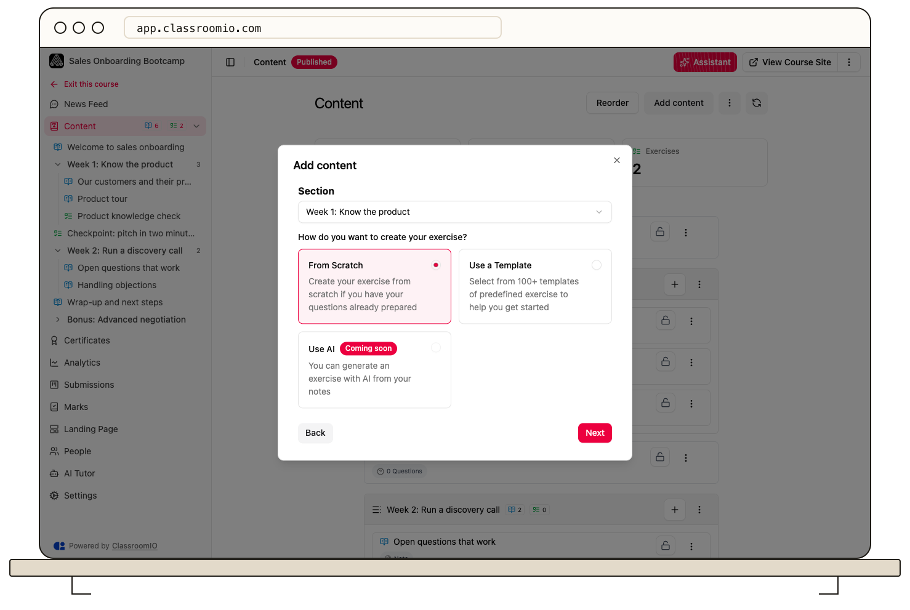

To start from prepared questions, choose **Use a Template** when adding an exercise. The exercise dialog’s **Use AI** option is currently marked **Coming soon**; use the course assistant for AI-assisted course content.

## Create from an exercise template

### 1. Open exercise creation

Open your course's **Content**, select **Add content**, choose **Exercise**, and select **Continue**. You need administrator or tutor access to manage the course content.

### 2. Choose a template

Select **Use a Template**, then **Next**. Choose a category to load its templates, select the template you want, and select **Finish**.

If a category has no templates, choose another category or return to **From Scratch**. A template must be selected before you can finish.

### 3. Review the copied questions

Open the exercise. Update the title and instructions, remove unsuitable questions, and check every correct answer and point value. A template gives you a starting assessment; it does not guarantee the content matches your lesson or audience.

Save the changes, then select **Preview** to inspect the result.

## Use the course assistant

Open **Assistant** in the course header and describe the exercise you want, including the source lesson, question count, question types, and learning outcome. Review any proposed changes before running them, then inspect the resulting exercise and answer key.

For example: “Add a five-question single-answer quiz after the introduction lesson. Test the main safety rules and explain each correct answer.”

AI activity uses your organization's AI allowance. Review [usage and plan limits](/get-started/understand-usage-and-plan-limits) if the assistant is unavailable.

The disabled **Use AI** choice in the exercise creation dialog does not start this workflow. Do not wait for that control to generate questions.

## Related guides

- [Create an exercise](/create-and-deliver/create-exercise) — add questions and an assessment
- [Set answers, points, and automatic grading](/build-courses/set-answers-points-and-automatic-grading) — configure scoring before students submit
- [Preview an exercise before publishing](/build-courses/preview-an-exercise-before-publishing) — review the assessment students will see
