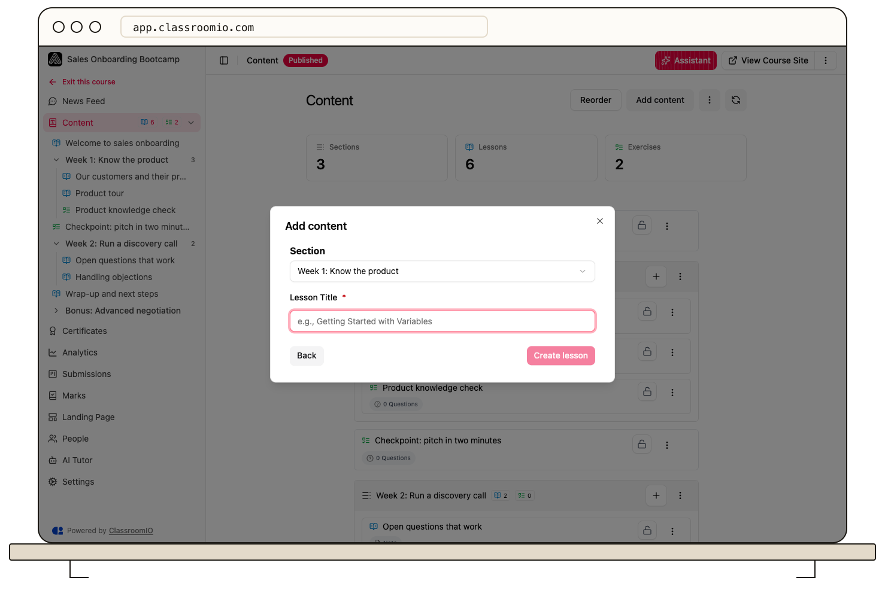

Create a lesson from **Content → Add content → Lesson**, then open it and select **Edit** to add teaching materials. A lesson can contain notes, videos, slide decks, and documents.

## Create a lesson

### 1. Choose its position

Open your course's **Content** page. Select **Add content**, or use the add control on a section to create the lesson inside that section. You need administrator or tutor access to manage the course content.

### 2. Enter a title

Choose **Lesson**, select **Continue**, enter **Lesson Title**, and select **Create lesson**. The lesson appears in the outline. Open it to start editing.

## Add and save materials

### 1. Open Edit

On the lesson page, select **Edit**. Update the title and choose the material tab you need:

- **Note** for written content and rich formatting.
- **Video** for links, uploads, or videos from your library.
- **Slide** for supported presentation embeds.
- **Docs** for PDF or Word attachments.

The tab order can differ between courses because it is configurable in course settings.

### 2. Save and review

Lesson edits autosave after you stop typing. Watch for **Saved**, and use the save control to finish a deliberate edit. Check the lesson in view mode before leaving. If saving fails, keep the editor open and check your connection rather than assuming the changes reached the server.

For scheduling or completion requirements, open the lesson's **Settings** tab and save the relevant settings. Live-session changes have their own save action.

## Make the lesson available

Check its **Lock** or **Unlock** control. Publishing a course does not override a locked lesson, and sequential progression can add a separate requirement to complete earlier items.

Preview the lesson as a student and use a separately enrolled demo student to verify access. In public courses, test the signed-out public page instead.

## Related guides

- [Write lesson content in the editor](/build-courses/write-lesson-content-in-the-editor) — format your lesson notes
- [Add or upload a video](/build-courses/add-or-upload-a-video) — choose a video source
- [Recover drafts and use version history](/build-courses/recover-drafts-and-use-version-history) — recover lesson note changes
- [Control progression and completion](/create-and-deliver/course-progression) — choose when students can continue
