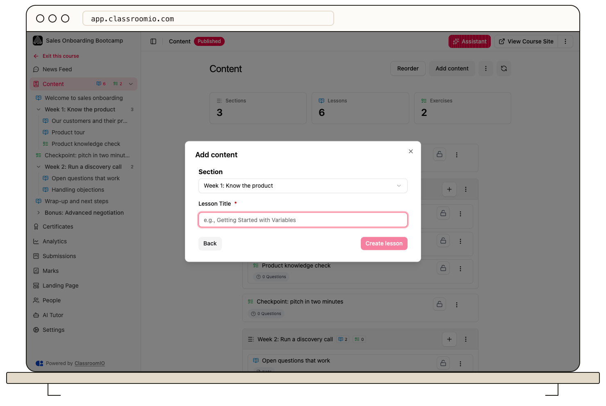
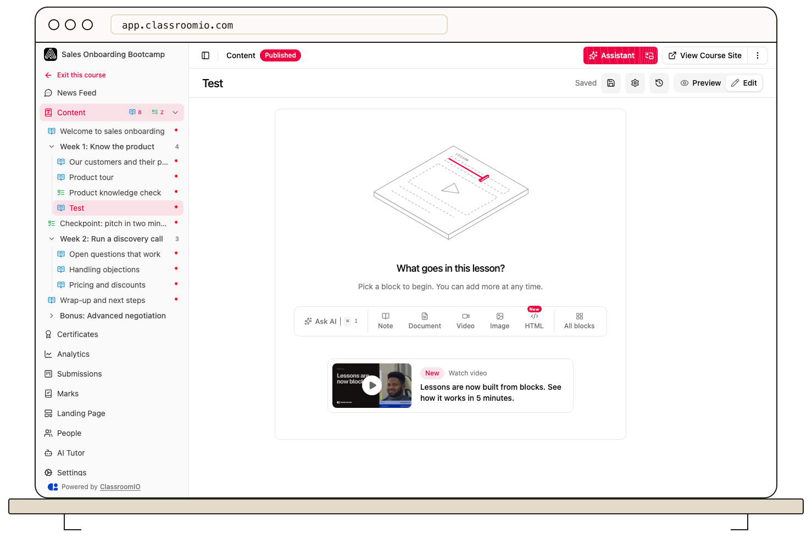

Create a lesson from **Content → Add content → Lesson**, then open it and select **Edit** to build it from blocks. A lesson is an ordered list of note, video, slides, document, image, chart, flashcards, tabs, multiple choice, process, and HTML blocks that students see from top to bottom.

## Create a lesson

### 1. Choose its position

Open your course's **Content** page. Select **Add content**, or use the add control on a section to create the lesson inside that section. You need administrator or tutor access to manage the course content.

### 2. Enter a title

Choose **Lesson**, select **Continue**, enter **Lesson Title**, and select **Create lesson**. The lesson appears in the outline. Open it to start editing.

## Build the lesson from blocks

This video walks through adding, editing, and reordering blocks. The steps below cover the same ground in writing.

<YouTube id="9hpGCqzypLk" title="Introducing lesson blocks in ClassroomIO" />

### 1. Open Edit

On the lesson page, select **Edit** in the **Preview** / **Edit** toggle. Select the lesson title at the top of the page and type to rename it.

### 2. Add content blocks

Choose a block type:

- **Note** for written content and rich formatting.
- **Video** for links, uploads, or videos from your library.
- **Slides** for supported presentation embeds.
- **Document** for files students can view or download.
- **Image** for a single picture with alt text.
- **Chart** for a bar, line, pie, or donut chart with a title and up to 12 data points. On a pie or donut chart, students can hover a slice or a legend row to pick it out.
- **Flashcards** for a deck of question-and-answer cards. Students see one card at a time, click it (or press Space) to flip between the question and the answer, and use the arrows or the arrow keys to move through the deck. Nothing they do is saved.
- **Tabs** for a row of named tabs, each with a short note and an optional image or video. Students select a tab to see its note and media; the first tab opens when the lesson loads.
- **Multiple Choice** for one practice question with a single correct answer. Students choose an answer, select **Check answer**, and can **Try again**. Their answers are not saved or graded.
- **Process** for a walkthrough in steps. Students see one step at a time, use **Back** and **Next** (or the numbered circles) to move through it, and select **Start over** on the last step to return to the first.
- **HTML** for a web page of your own, such as an interactive explainer, a dashboard or a small game. The page is still until students select **Interact**, which lets them click and scroll inside it; pressing Escape or clicking outside the page stops interacting. The full-screen button opens the page in a full-screen view where students can use it right away.

A new lesson asks **What goes in this lesson?** and shows a grid with one tile per block type, an **Ask AI** button that sends your prompt to the AI assistant, which can write notes and add chart, flashcards, tabs, multiple choice and process blocks (or press Cmd+I on a Mac, Ctrl+I elsewhere, when you're not typing in a block), and a short video that introduces lesson blocks. Once the lesson has blocks, a bar at the bottom of the screen lists the same types and adds the block to the end of the lesson. To insert a block between two others, select the plus button between them and choose a tile. **Ask AI instead** in the same menu opens the Ask AI prompt; say in your prompt where the new content should go.

**Note**, **Video**, **Slides**, **Document**, and **Image** blocks start with example content so you can see the layout. Replace it before students use the lesson: type over the note, or select **Change Video**, **Change Slides**, **Change Document**, or **Change image** on the block. **Change image** opens the **Insert image** dialog, where you can upload a file, search Unsplash, or paste a link. A **Chart** block starts with an example bar chart: type over the title, and use the four buttons beside it to switch between bar, line, pie, and donut. Select **Edit data** to change each data point's label and value; the chart updates as you type. **Add data point** adds a row (up to 12), and the trash icon removes one (at least 1 must remain). Values can't be negative. A **Flashcards** block starts with three example cards: click the question text to type over it, and select the flip button in the card's corner to edit the answer. The numbers under the card list every card and jump to one, and **+** adds an empty card (up to 100). To remove the card you're viewing, select the trash icon next to the flip button. A deck always keeps at least one card. A **Tabs** block starts with three example tabs: select the open tab's name to rename it, type a note under the tabs, use **Add tab** to add one (up to 10), and select the X on the open tab to remove it together with its content (at least 1 must remain). **Tabs position** places the row on the left, center, or right. Under a tab's note, select **Add image** or **Add video** to show one picture or video in that tab; they open the same pickers as the Image and Video blocks. To replace it, select **Change image** or **Change video** on it; **Remove image** or **Remove video** clears it and brings back the two buttons. A tab doesn't hold other blocks. A **Multiple Choice** block starts with an example question: type over the question and answers, and select an answer's letter to mark it correct. Use **Add option** to add answers (up to 10), or the X on an answer to remove it (at least 2 must remain). To show one picture above the question, select the image button in the block's top-right corner and choose **Image**; the X on the picture removes it. A **Process** block starts with three example steps: type over the heading and text of the step you're viewing, and select a numbered circle to switch steps. Select the image button in the block's top-right corner and choose **Image** to add one picture to the current step, use the trash icon next to it to delete the current step (at least 1 must remain), and **Add step** to add one (up to 20). You can add as many blocks of each type as you need. Choosing **HTML** opens the **Add HTML** dialog instead of example content. On **Add**, select **Upload HTML file** (or drag a file in), or create the page with AI: pick Slides, Dashboard, Report, Explainer, Prototype or Game to start from a ready-made prompt, or describe your own idea, then send it. On **Paste code**, paste the HTML and select **Insert**. A page can be up to 2 MB, and creating or editing one with AI uses your organization's AI credits. On the block, drag the bottom corners to change its width and the bar in the middle of the bottom edge to change its height. **Edit with AI** (the sparkles button) changes the page from a short instruction, and **More actions** has **Replace HTML** and **Download HTML**. The page runs in an isolated frame, so its scripts can't reach the lesson, the student's account or your site, and it can't submit forms or load or send data over the network.

### 3. Arrange and remove blocks [#arrange-blocks]

Drag a block by its handle to move it, or open the block's **⋯** (Block actions) menu and choose **Move up** or **Move down**. Choose **Remove block** in the same menu to delete it from the lesson.

### 4. Save and review

Adding, moving and removing blocks saves right away. Note text and other edits inside a block save shortly after you stop typing or clicking, and opening another lesson saves them first. If you reload or close the tab while block edits are still saving, your browser asks you to confirm. The **Saved** label in the lesson header covers the lesson title and settings, not note text. Before you leave, select **Preview** (or the save icon) to read the lesson the way students see it and check that your text is there. If a block change cannot be saved, an error message gives the reason and the block returns to how it was before the change, so redo the change once you have fixed the cause. If saving fails for another reason, stay on the page and check your connection rather than assuming the changes reached the server.

For language, access, scheduling, completion, comment, and reading density options, select the settings icon in the lesson header to open **Lesson settings**. These options save automatically, except a live session, which has its own **Save session** button.

## Make the lesson available

Check the **Access** switch in **Lesson settings**: a lesson shows **Released** or **Not released yet**. Students see an unreleased lesson in the outline but can't open it. Publishing a course does not release it, and sequential progression can add a separate requirement to complete earlier items.

Select **Preview** to check the content, and use a separately enrolled demo student to verify access. In public courses, test the signed-out public page instead.

## Related guides

- [Write lesson content in the editor](/build-courses/write-lesson-content-in-the-editor) — format your note blocks
- [Add or upload a video](/build-courses/add-or-upload-a-video) — choose a video source
- [Recover drafts and use version history](/build-courses/recover-drafts-and-use-version-history) — recover lesson note changes
- [Set lesson completion rules](/deliver-and-engage/set-lesson-completion-rules) — choose when the lesson counts as finished
- [Control progression and completion](/create-and-deliver/course-progression) — choose when students can continue
