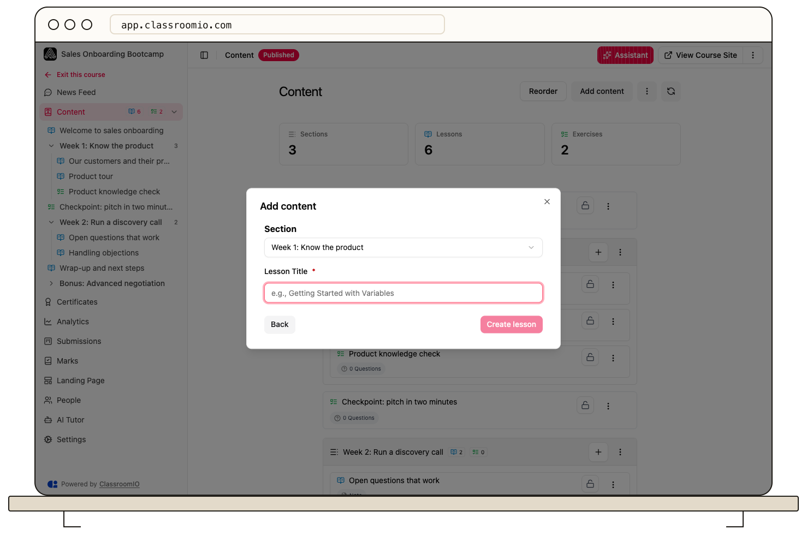
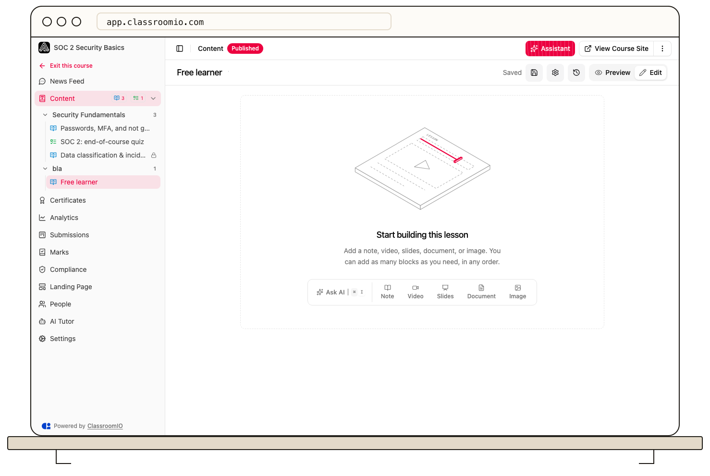

Create a lesson from **Content → Add content → Lesson**, then open it and select **Edit** to build it from blocks. A lesson is an ordered list of note, video, slides, document, and image blocks that students see from top to bottom.

## Create a lesson

### 1. Choose its position

Open your course's **Content** page. Select **Add content**, or use the add control on a section to create the lesson inside that section. You need administrator or tutor access to manage the course content.

### 2. Enter a title

Choose **Lesson**, select **Continue**, enter **Lesson Title**, and select **Create lesson**. The lesson appears in the outline. Open it to start editing.

## Build the lesson from blocks

### 1. Open Edit

On the lesson page, select **Edit** in the **Edit** / **Preview** toggle. Select the lesson title at the top of the page and type to rename it.

### 2. Add content blocks

Choose a block type from the **Add content** row:

- **Note** for written content and rich formatting.
- **Video** for links, uploads, or videos from your library.
- **Slides** for supported presentation embeds.
- **Document** for files students can view or download.
- **Image** for a single picture with alt text.

A new lesson shows the **Add content** row in the middle of the page. Once the lesson has blocks, the row stays at the bottom of the screen and adds the block to the end of the lesson. To insert a block between two others, select the plus button below a block and choose the type.

**Note**, **Video**, **Slides**, and **Image** blocks start with example content so you can see the layout. Replace it before students use the lesson: type over the note, or select **Change Video**, **Change Slides**, or **Change image** on the block. **Document** opens the upload dialog straight away. You can add as many blocks of each type as you need.

### 3. Arrange and remove blocks [#arrange-blocks]

Drag a block by its handle to move it, or open the block's **⋯** (Block actions) menu and choose **Move up** or **Move down**. Choose **Remove block** in the same menu to delete it from the lesson.

### 4. Save and review

Block changes save as you make them, and note text saves shortly after you stop typing. The **Saved** label in the lesson header covers the lesson title and settings, not note text. Before you leave, select **Preview** (or the save icon) to read the lesson the way students see it and check that your text is there. If saving fails, stay on the page and check your connection rather than assuming the changes reached the server.

For access, scheduling, completion, and comment options, select the settings icon in the lesson header to open **Lesson settings**. These options save automatically, except a live session, which has its own **Save session** button.

## Make the lesson available

Check the **Access** switch in **Lesson settings**: a lesson shows **Unlocked** or **Locked**. Publishing a course does not override a locked lesson, and sequential progression can add a separate requirement to complete earlier items.

Select **Preview** to check the content, and use a separately enrolled demo student to verify access. In public courses, test the signed-out public page instead.

## Related guides

- [Write lesson content in the editor](/build-courses/write-lesson-content-in-the-editor) — format your note blocks
- [Add or upload a video](/build-courses/add-or-upload-a-video) — choose a video source
- [Recover drafts and use version history](/build-courses/recover-drafts-and-use-version-history) — recover lesson note changes
- [Set lesson completion rules](/deliver-and-engage/set-lesson-completion-rules) — choose when the lesson counts as finished
- [Control progression and completion](/create-and-deliver/course-progression) — choose when students can continue
