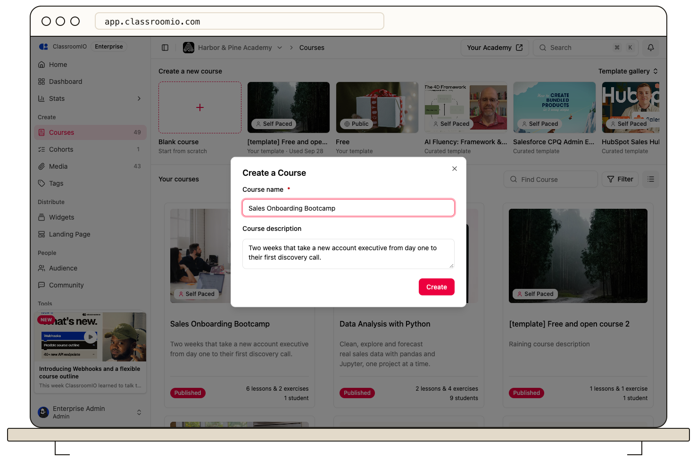

To duplicate a course in your organization, open its course actions and select **Clone**. To move material from another platform through the dashboard, create a course and add the source content as lessons, media, and exercises.

## Duplicate an existing course

### 1. Open the course actions

As an administrator, open **Courses** and find the course you want to copy. Open the three-dot menu on its course card and select **Clone**.

### 2. Name the copy

Enter a distinct **Course name** and review the description in the dialog.

:::warning[Review the copy's publishing state]
A clone inherits the source course's publishing state. Cloning a published course can create another published course. If the copy must stay private while you edit it, turn off **Publish Course** in the copy's **Settings** immediately.
:::

Select **Create**. ClassroomIO opens the copied course. Its sections, lessons, exercises, and course settings are copied; student memberships and submissions are not transferred. Review the copy's access, dates, and content locks before inviting students.

A clone is independent of its source. For a reusable starting point with optional updates, [save a course as a template](/build-courses/save-a-course-as-a-template) instead.

## Bring material from another platform

The dashboard's blank course creator does not offer a course-file importer. A ZIP, SCORM package, or export from another LMS is not a lesson document upload.

1. [Create an empty course](/build-courses/create-a-course-from-scratch).
2. Recreate the outline with sections and lessons.
3. Paste written material into the lesson **Note** editor.
4. Add supported videos, presentation embeds, and PDF or Word documents.
5. Recreate exercises, answer keys, and points, then test the course with a demo student.

Do not assume that the source platform's enrollments, grades, or completion records move with the content. Keep those records separately when planning a migration.

## Related guides

- [Create a course from scratch](/build-courses/create-a-course-from-scratch) — start with an empty course
- [Create a course from a template](/build-courses/create-a-course-from-a-template) — reuse a prepared course
- [Create and edit a lesson](/build-courses/create-and-edit-a-lesson) — add teaching materials
- [Create an exercise](/create-and-deliver/create-exercise) — add questions and an assessment
