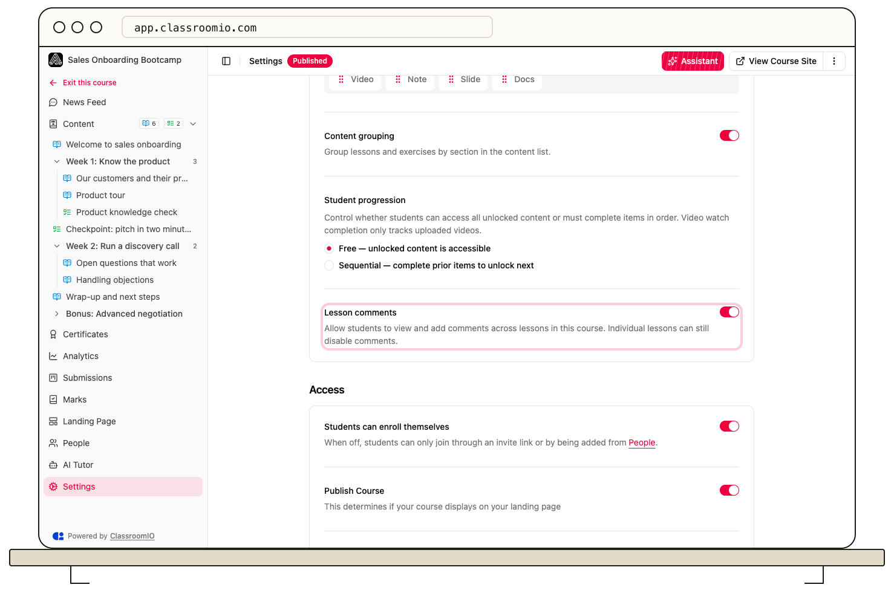

Use course **Settings** to control lesson comments and PDF downloads. Public lesson Markdown export has its own setting, while the separate **Course download** button currently shows **Coming soon**.

## Enable lesson comments

1. Open the course's **Settings → Content**.
2. Turn **Lesson comments** on or off.
3. Select **Save changes**.

Administrators and tutors with course access can edit these settings. Turning course comments off prevents students from viewing and adding comments across lessons. An individual lesson can also disable comments, so check that lesson's **Settings** if comments are unavailable while the course-level control is on.

## Allow lesson PDF downloads

Lesson PDF downloads require a paid plan.

1. In course **Settings → Access**, turn on **Lesson download**.
2. Select **Save changes**.
3. Open a lesson as a registered demo student and check its PDF download action.

This setting allows registered students to download lessons as PDF. It is separate from attaching a PDF or Word file in a lesson's **Docs** tab. See [Add documents and downloads](/build-courses/add-documents-and-downloads) for attachments.

## Allow public Markdown export

:::warning[This creates public text access]
Enabling **Allow learners to copy lesson pages as Markdown** exposes a public Markdown URL for each unlocked public lesson. Enable it only for content you intend to make available that way.
:::

Turn on the Markdown setting under **Access** and select **Save changes**. Public lesson pages show **Copy Page**, which exports the lesson content as Markdown and excludes videos. Test the signed-out public page to confirm the result.

## Downloading a whole course

The **Course download → Download** control currently displays **Coming soon**. It does not produce a working course backup or migration package. Do not rely on it to preserve your only copy of course material.

To reuse content inside ClassroomIO, [clone the course](/build-courses/duplicate-or-import-a-course) or [save it as a template](/build-courses/save-a-course-as-a-template).

## Related guides

- [Add documents and downloads](/build-courses/add-documents-and-downloads) — attach student resources
- [Create a public course](/build-courses/create-a-public-course) — review anonymous lesson access
- [Duplicate or import a course](/build-courses/duplicate-or-import-a-course) — reuse an existing course
