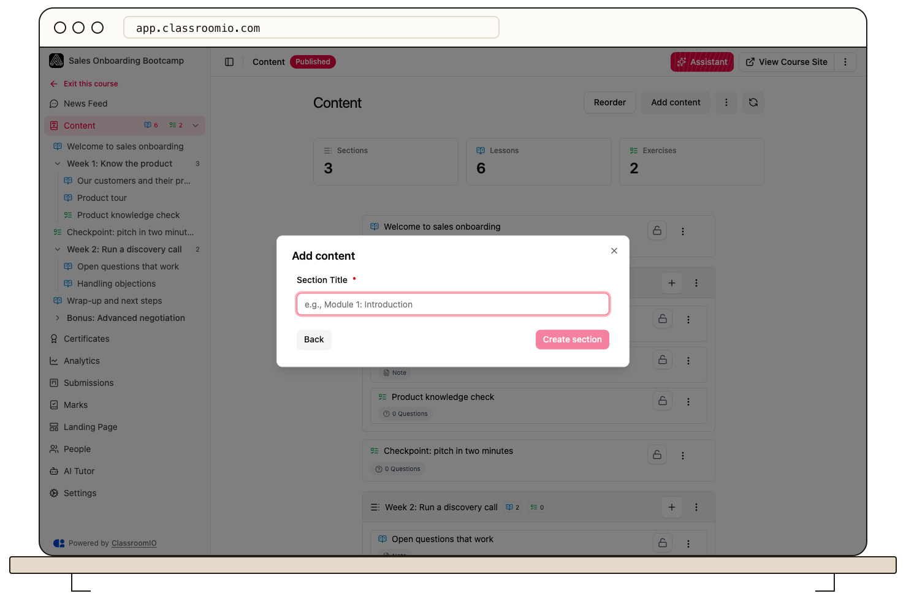

Sections group related lessons and exercises in your course outline. Open **Content → Add content → Section** to add one; lessons and exercises can also sit outside sections.

See [Section, lesson, and exercise](/troubleshooting-and-reference/section-lesson-and-exercise) if you need to choose which kind of item to add.

## Add a section

### 1. Open the course outline

Open your course and select **Content**. Administrators and tutors with course access can manage the outline.

### 2. Create the section

Select **Add content**, choose **Section**, and select **Continue**. Enter **Section Title**, then select **Create section**. The new section appears in the course outline and sidebar.

### 3. Put content in the section

Use the add control on the section to create a lesson or exercise within it. To move existing material, select **Reorder** and drag the lesson or exercise into the section. You can also move an item out so it stands on its own. Reordering saves when you drop the item; select **End Reorder** when finished.

Move a whole section to keep its contents together. See [Create and reorder lessons and exercises](/build-courses/create-and-reorder-lessons-and-exercises) for the full ordering workflow.

## Rename a section

Open the section's three-dot menu, choose **Edit**, update the title, and select **Save**. The title helps students recognize the topic; it does not change the content's completion requirements.

## If sections do not appear

Check **Settings → Content → Content grouping**, or open **Content options** on the Content page and choose **Enable content grouping**. Turning grouping off displays a flat list; you can turn it back on to use the section layout again.

Grouping and progression are separate settings. A section title alone does not require students to complete its items in order.

## Related guides

- [Create and reorder lessons and exercises](/build-courses/create-and-reorder-lessons-and-exercises) — move items within or between sections
- [Turn content grouping on or off](/build-courses/turn-content-grouping-on-or-off) — choose grouped or flat presentation
- [Control progression and completion](/create-and-deliver/course-progression) — choose when students can continue
