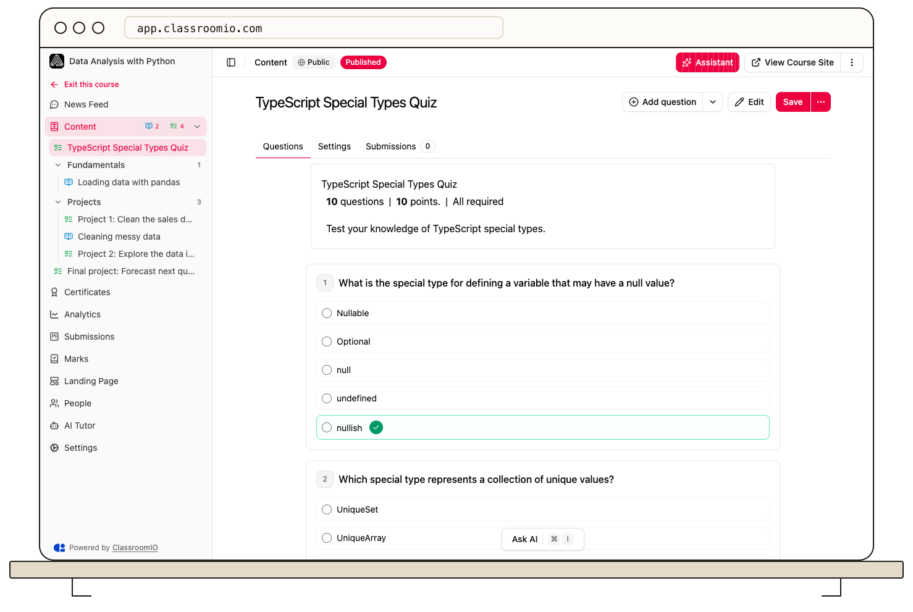

Select **Preview** on an exercise’s **Questions** tab to inspect its student-facing question layout. Use a separate demo student to test saved answers, grading, and access before sharing the course.

## Preview the questions

### 1. Open the exercise

Open your course's **Content**, choose the exercise, and select **Questions**. You need administrator or tutor access to edit and preview it.

### 2. Select Preview

Select **Preview** in the header. Review question wording, instructions, response options, embedded content, and section boundaries. Check that the order is understandable and the response format matches the task.

The preview reflects the assessment you are editing. It does not prove that unsaved edits reached the server or that an enrolled student can access the exercise.

### 3. Correct and save

Select **Edit** to return to the editor. Fix problems, confirm correct responses and points, then select **Save**. Preview again if the changes affect what students see.

## Test the full student flow

Use a separately enrolled demo student to open the saved course. Check:

- The exercise is available when intended, including content locks and prerequisites.
- A student can answer and submit the questions.
- The score or instructor-review state matches the question types.
- The completion rule and any next-item unlock behave as intended.
- Multiple attempts work as configured, especially when passing is required.

For public courses, open the public course page in a signed-out browser and test the exercise there. Public exercises use anonymous browser scoring rather than the enrolled-student submission flow.

## Publish when the whole course is ready

An exercise has availability and completion settings within its course. The preview control does not publish the course or enroll anyone. Review the course's publishing and enrollment settings separately before sharing it.

## Related guides

- [Set answers, points, and automatic grading](/build-courses/set-answers-points-and-automatic-grading) — configure scoring before students submit
- [Control progression and completion](/create-and-deliver/course-progression) — choose when students can continue
- [Publish a course and allow self-enrollment](/build-courses/publish-a-course-and-allow-self-enrollment) — make the finished course available
