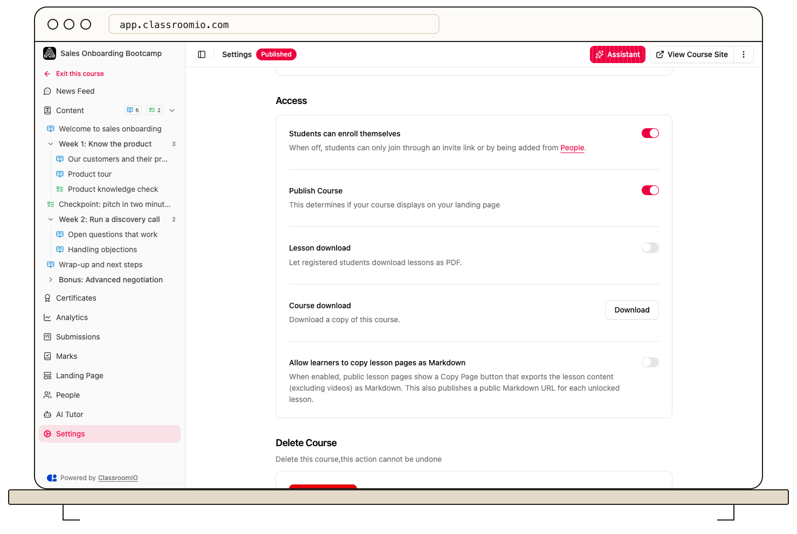

Turn on **Publish Course** in course **Settings → Access** to display the course on your landing page. **Students can enroll themselves** is a separate control that decides whether students can join without an invitation.

## Before publishing

Review the course's lessons, exercises, answer keys, completion requirements, and student access. If the course contains private material, choose the access model before turning on publishing. Administrators and tutors with course access can manage these settings.

For a compliance course, set **Course Completion Deadline** first. Publishing and enrollment are blocked without the required deadline.

## Publish and choose enrollment

### 1. Open Access settings

Open the course and select **Settings → Access**.

### 2. Decide who can join

Turn **Students can enroll themselves** on if students should join through the normal self-enrollment flow. Turn it off when students should join through an invitation or be added from **People**.

Organization access and paid enrollment can add other requirements. See [Control enrollment access](/manage-students/enrollment-access-control) before sharing a self-enrollment link.

Public courses use anonymous access rather than the normal enroll-and-LMS flow. For those courses, review [Create a public course](/build-courses/create-a-public-course) and test without signing in.

### 3. Publish the course

Turn on **Publish Course** and select **Save changes**. Check the course's **Published** badge.

Publishing does not enroll anyone or unlock every lesson and exercise. If the settings show locked items, review them and use **Unlock all** only if all of that content should be released now. You can instead unlock individual items from **Content**.

### 4. Test the actual access path

If **Course Link** in **Settings → General** asks you to set up a landing page, select **Set up landing page** and [finish the course landing page](/publish-and-brand/course-landingpage) first. Then open **View Course Site** and inspect it. Use a separately enrolled demo student, or a new demo account for self-enrollment, to check the full join flow and content access. An administrator's view does not prove a student's permissions.

## Stop listing the course

Turn off **Publish Course** and save to remove the course from the landing page. Use enrollment and content access controls separately when deciding what existing students should be able to open; unpublishing is not a substitute for reviewing those permissions.

## Related guides

- [Control enrollment access](/manage-students/enrollment-access-control) — review organization and course access together
- [Control progression and completion](/create-and-deliver/course-progression) — choose when students can continue
- [Preview your academy as a learner](/get-started/preview-your-academy-as-a-learner) — test public and signed-in views
