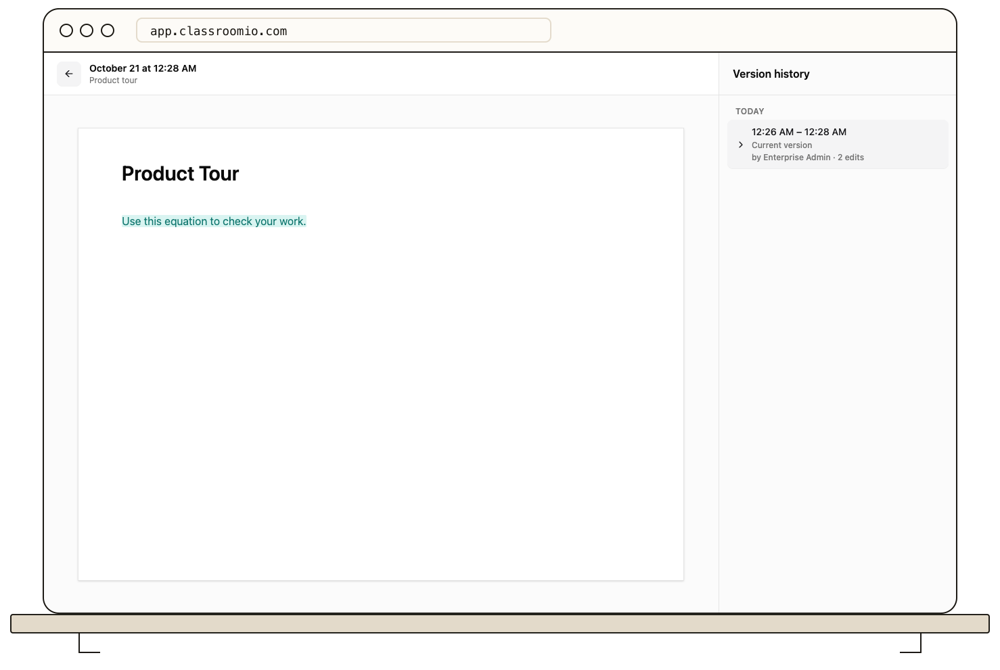

Lesson notes save a local recovery draft while you edit and keep saved versions in **Version history**. Use draft recovery after an interrupted edit, or review a saved version before restoring it.

## Recover an interrupted edit

When you reopen a lesson that has a different local draft, ClassroomIO asks whether you want to restore it. Accept to load the draft into the editor, review the text, and save it. Declining removes that local recovery draft.

A local draft belongs to that browser and lesson language. It is not a backup across devices, and clearing site data can remove it. A draft matching the saved note is cleared automatically.

Keep the browser open if a save fails. Check your connection, then confirm the **Saved** indicator before leaving the lesson.

## Restore saved note content

### 1. Choose the lesson and language

Open your course's **Content**, then the lesson. Choose the language whose note you want to review. Administrators and tutors with editing access can restore versions.

### 2. Open Version history

Select **Version history** in the lesson header. Choose an entry to inspect the text changes. Entries show when changes were saved and can group autosaves into an editing session. Use **Fetch more versions** to load older entries.

If the panel shows **No versions yet**, there is no saved note history for that selection. Check the lesson and language before assuming the content is lost.

### 3. Restore the selected version

:::warning[Restoring replaces the current note]
Copy any current text you want to keep before restoring. **Restore this version** writes the selected note content back to the lesson and creates a saved version. It does not restore the entire course, lesson title, videos, slides, documents, or session settings.
:::

Select **Restore this version**, then check the note in the lesson. Confirm you restored the intended language and content before making further edits.

## Related guides

- [Write lesson content in the editor](/build-courses/write-lesson-content-in-the-editor) — format your lesson notes
- [Create and edit a lesson](/build-courses/create-and-edit-a-lesson) — add teaching materials
