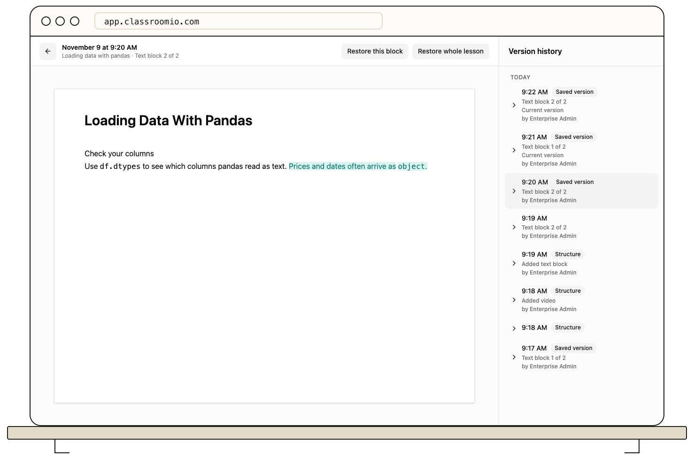

Lessons save a local recovery draft while you edit and keep a history of recent changes in **Version history**: edits to each text block, and blocks being added, removed, moved or changed. Older autosaves are thinned to hourly and then daily snapshots and removed after about 30 days; manual saves, publishes and restores are kept. Changes to the lesson title and to **Lesson settings**, apart from **Videos to enforce**, are not part of Version history. Use draft recovery after an interrupted edit, or use Version history to restore one text block, roll the whole lesson back, or undo an AI assistant change.

## Recover an interrupted edit

When you reopen a lesson that has a different local draft, ClassroomIO asks whether you want to restore it. Accept to load the draft into the editor, review the text, and save it. Declining removes that local recovery draft.

A local draft belongs to that browser and lesson language. It is not a backup across devices, and clearing site data can remove it. A draft matching the saved note is cleared automatically.

Keep the browser open if a save fails. Check your connection, then confirm the **Saved** indicator before leaving the lesson.

## Review the lesson's history

### 1. Choose the lesson and language

Open your course's **Content**, then the lesson. Choose the language you want to review from the top of **Lesson settings** (the settings icon in the lesson header). Administrators and tutors with editing access can open Version history and restore versions.

### 2. Open Version history

Select **Version history** in the lesson header. Entries are grouped by day, newest first:

- **Text entries** show the changes to one text block. When a lesson has several text blocks, the entry says which one, for example **Text block 2 of 3**. Edits to a text block that was later removed are labelled **Removed text block**.
- **Structure entries** list the blocks that were added, removed, moved or changed at that point. The first structure entry marks the starting point, how the blocks were laid out before the first recorded change, and lists no changes.
- Entries made by the AI assistant are marked **Assistant**, and entries made by a restore or undo are marked **Restore**.
- Entries made by an AI client connected through MCP, such as Claude or ChatGPT, show that client's name, with its logo when it is one we have a logo for, and otherwise the first letter of its name in a small badge. The person who connected it is still shown as the author. These entries can be restored from, but not undone with **Undo**.
- Entries made through a public API key are marked with the key's label, or **API** when the key has no usable label. The key's creator is shown as the author, and these entries can be restored from, but not undone with **Undo**.

Use **Fetch more versions** to load older entries. If the panel shows **No versions yet**, there is no saved history for that selection. Check the lesson and language before assuming the content is lost.

## Restore a version

:::warning[Restoring replaces current content]
Copy any current text you want to keep before restoring. Every restore is saved as a new entry in Version history, so you can restore again if you pick the wrong version. Restores do not change the lesson title or **Lesson settings**, with one exception: restoring the whole lesson puts back the **Videos to enforce** choices from that moment, and undoing a change reverts any **Videos to enforce** choice that change made, because that choice is stored on each video block.
:::

### Restore one text block

Choose an older text entry and select **Restore this block**. It is not offered on a block's current version or on **Removed text block** entries; use **Restore whole lesson** to bring a removed block back. Only that block's text, in the selected language, goes back to the chosen version. If the block is shared with other lessons, this lesson gets its own copy and the other lessons keep their current text.

### Restore the whole lesson

Choose any entry except the newest, select **Restore whole lesson**, then confirm. The lesson's blocks, their order and settings, and the text of every block in every language go back to how they were at that moment. Blocks added since then are removed from the lesson.

- A block removed from every lesson can be brought back for 30 days. After that it is deleted for good and the restore skips it.
- Text that has no saved version from that moment keeps its current content.
- If a block is now shared with other lessons, this lesson gets its own copy instead of changing theirs.
- Block order is only recorded from a lesson's first block change onwards, and kept day by day for 30 days. For older entries, the restore puts back the text and the nearest earlier recorded block layout, or leaves the blocks as they are if none is recorded.

## Undo an AI assistant change

Everything the AI assistant changes in one chat request is grouped together. Choose an entry marked **Assistant** and select **Undo** to revert that whole request: the text it wrote and any blocks it added, removed or moved. Nothing else in the lesson changes. You can also undo a restore the same way.

Undo is refused when a text block it wrote has been edited since or, if it added, removed, moved or changed blocks, when any block in the lesson has been added, removed, moved or changed since. In that case, restore the version you want instead. When you undo several changes, undo the newest one first. If the assistant moved a block to another lesson, undo the change in the lesson it moved to first, then in the lesson it came from.

You can also ask the assistant in chat to undo one of its recent changes or to go back to a recent version. It reads the 20 newest history entries.

## Related guides

- [Write lesson content in the editor](/build-courses/write-lesson-content-in-the-editor) — format your lesson notes
- [Create and edit a lesson](/build-courses/create-and-edit-a-lesson) — add teaching materials
