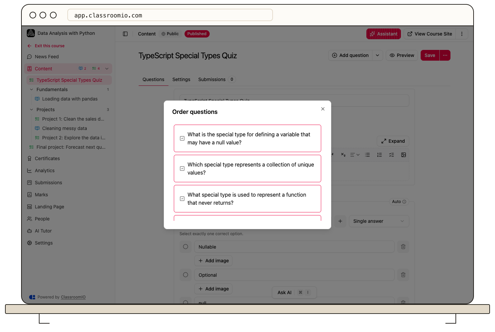

Open an exercise’s **Questions** tab, use the menu beside **Save**, and select **Reorder Questions**. Arrange the questions, then save the exercise to keep the new sequence.

## Reorder an exercise without sections

### 1. Open the ordering dialog

Open the exercise from the course's **Content** page and choose **Questions**. Open the more-actions menu beside **Save**, then select **Reorder Questions**. Administrators and tutors with course access can reorder questions.

### 2. Arrange the questions

Drag each question to the position you want. Use the question titles to confirm that you are moving the intended item. Close the dialog when the sequence is correct.

### 3. Save and preview

Select **Save** in the exercise header. Reordering the dialog changes your editing draft; closing the dialog alone does not save the exercise to the server.

Select **Preview** and read through the questions in order. Check instructions that refer to earlier questions so they still make sense.

## Reorder an exercise with sections

When the exercise has its own question sections, **Reorder Questions** switches to inline ordering instead of opening the flat dialog. Drag questions within their sections, finish with the reorder completion action, and select **Save**.

These exercise sections are different from the sections in the course outline. Reordering course sections does not rearrange the questions inside an exercise.

:::warning[Review an assessment already in use]
Reordering changes the sequence students see. Review references such as “the previous question” and any section routing before changing a live assessment.
:::

## Related guides

- [Create an exercise](/create-and-deliver/create-exercise) — add questions and an assessment
- [Preview an exercise before publishing](/build-courses/preview-an-exercise-before-publishing) — check the saved question sequence
- [Create and reorder lessons and exercises](/build-courses/create-and-reorder-lessons-and-exercises) — change the course outline instead
