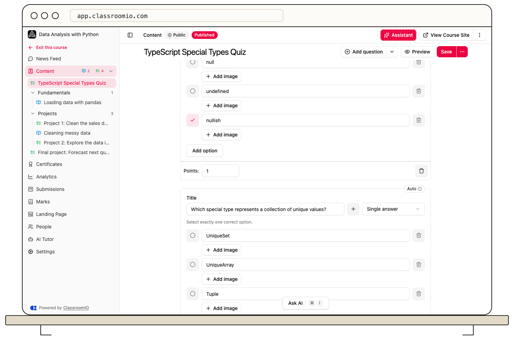

Set each question’s correct response and points in the exercise editor. Exercises made entirely of supported automatically graded questions can be scored on submission; questions needing judgment require instructor review.

## Configure scoring

### 1. Open Questions

Open the exercise from your course's **Content**, then choose **Questions**. Add or select the question you want to configure. You need administrator or tutor access to edit the assessment.

### 2. Set the response and answer key

Choose the question type, write the question, and fill in the response options or type-specific settings. For single-answer questions, mark the correct option. For multiple-answer questions, mark every correct option. Numeric, blank, ordering, and word-bank questions have their own answer fields.

Do not treat a question title and several options as a complete answer key. Open [Choose an exercise question type](/build-courses/choose-an-exercise-question-type) when deciding which response format fits the learning outcome.

### 3. Set points and save

Enter the points the question can earn. An exercise made entirely of automatically graded types requires positive points for its questions. Resolve any validation errors and select **Save**.

Check the grading badge near the exercise title. **Auto-grade** identifies an exercise that can be scored automatically; a manual-grading badge means instructor review is needed. Mixing an instructor-reviewed response into a quiz means you should plan to review its submissions.

## Keep completion separate from scoring

In the exercise's **Settings**, choose whether completion requires a submission or a passing result, and set the passing percentage when needed. A score alone does not decide whether students can continue unless the completion and course progression settings use it.

If students must pass, consider enabling multiple attempts. With manual questions, students may wait for a tutor's grade before a passing requirement can be evaluated. Review the warning shown when saving the requirement.

## Verify with a test submission

Select **Preview** to inspect the question layout, then test the saved exercise with a demo student. Check a correct and an incorrect response, the resulting score, and the completion outcome. Public exercises score in the browser and do not provide the normal enrolled-student submission workflow.

## Related guides

- [Choose an exercise question type](/build-courses/choose-an-exercise-question-type) — compare response and grading formats
- [Grade an exercise](/create-and-deliver/grade-exercise) — review responses that need an instructor
- [Control progression and completion](/create-and-deliver/course-progression) — choose when students can continue
