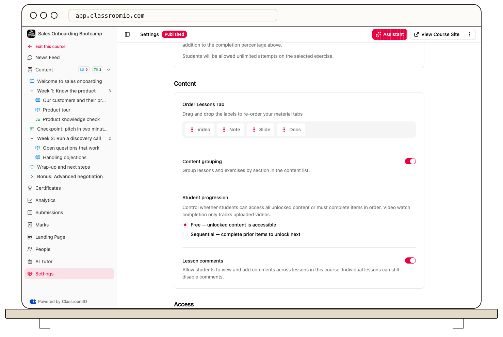

In course **Settings → Content**, **Order Lessons Tab** changes the order of material tabs inside lessons, while **Content grouping** controls sections in the course outline. To reorder lessons and exercises themselves, use **Reorder** on the Content page.

## Change lesson material tab order

1. Open your course's **Settings** and find **Content**.
2. Under **Order Lessons Tab**, drag **Video**, **Note**, **Slide**, and **Docs** into the order you want.
3. Select **Save changes**.
4. Open a lesson and confirm the material tabs appear in the intended order.

This is a course-wide presentation setting, not a way to move a lesson before another lesson. You need administrator or tutor access to edit course settings.

## Show sections or a flat list

In the same **Content** settings card, turn **Content grouping** on to group lessons and exercises under sections, or off to show a flat list. Select **Save changes** to apply it.

You can also change grouping directly from **Content options** on the Content page; that action saves immediately. See [Turn content grouping on or off](/build-courses/turn-content-grouping-on-or-off).

## Change the learning sequence

Open **Content**, select **Reorder**, and move lessons, exercises, or sections. These changes save as you drop the items. Select **End Reorder** when finished.

With **Sequential** progression, the outline order affects which content a student must complete first. Material tab order and section grouping do not by themselves impose that requirement. Review [progression and completion](/create-and-deliver/course-progression) when changing a course students already use.

## Related guides

- [Create and reorder lessons and exercises](/build-courses/create-and-reorder-lessons-and-exercises) — arrange the learning sequence
- [Turn content grouping on or off](/build-courses/turn-content-grouping-on-or-off) — choose the outline presentation
- [Control progression and completion](/create-and-deliver/course-progression) — choose when students can continue
