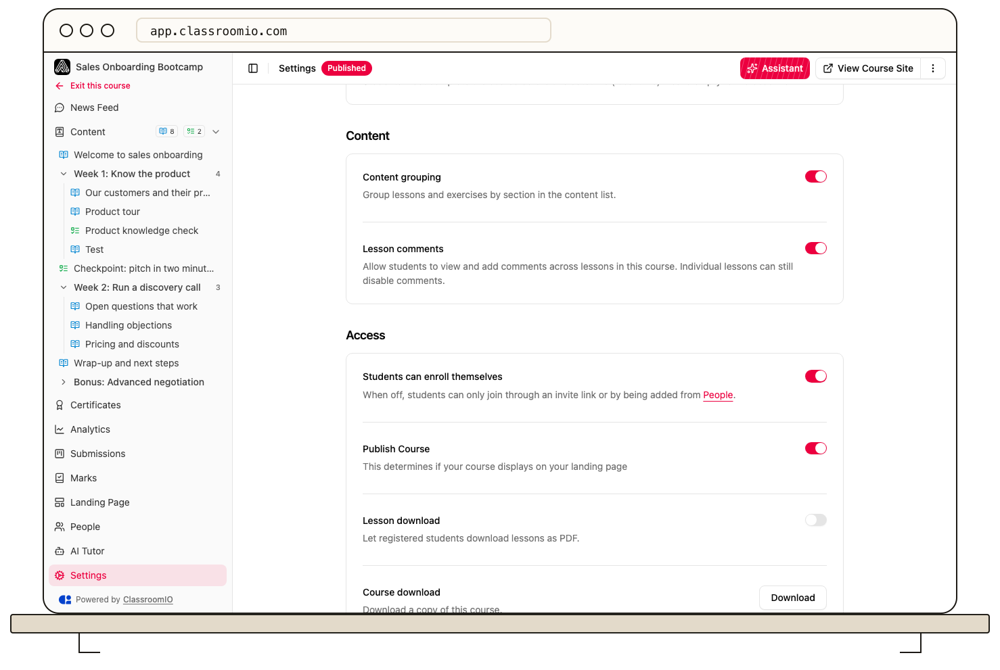

In course **Settings → Content**, **Content grouping** controls whether the course outline uses sections. To change the order of lessons, exercises, and sections, use **Reorder** on the Content page. **Order Lessons Tab** in the same card only applies to the older tab-based lesson editor; it does not change the order of blocks in a lesson.

## Show sections or a flat list

Open your course's **Settings** and find the **Content** card. Turn **Content grouping** on to group lessons and exercises under sections, or off to show a flat list. Select **Save changes** to apply it. You need administrator or tutor access to edit course settings.

You can also change grouping directly from **Content options** on the Content page; that action saves immediately. See [Turn content grouping on or off](/build-courses/turn-content-grouping-on-or-off).

## Change the learning sequence

Open **Content**, select **Reorder**, and move lessons, exercises, or sections. These changes save as you drop the items. Select **End Reorder** when finished.

With **Sequential** progression, the outline order affects which content a student must complete first. Section grouping does not by itself impose that requirement. Review [progression and completion](/create-and-deliver/course-progression) when changing a course students already use.

## Related guides

- [Create and reorder lessons and exercises](/build-courses/create-and-reorder-lessons-and-exercises) — arrange the learning sequence
- [Turn content grouping on or off](/build-courses/turn-content-grouping-on-or-off) — choose the outline presentation
- [Control progression and completion](/create-and-deliver/course-progression) — choose when students can continue
