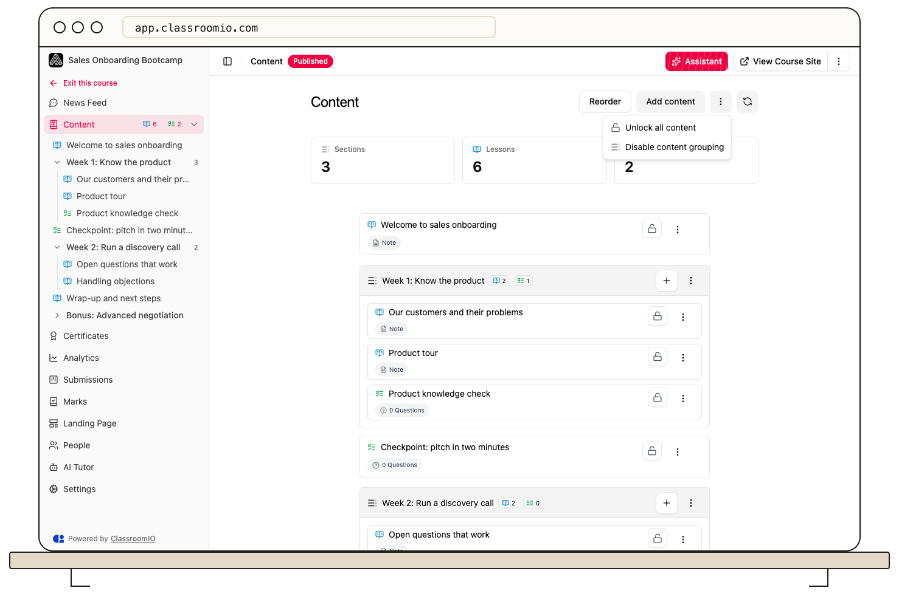

Content grouping controls whether lessons and exercises appear under sections or in a flat list. Change it from **Content options** on the Content page, or from course **Settings**.

## Change grouping from Content

1. Open the course and select **Content**.
2. Open **Content options**, the three-dot menu beside the page's add and refresh controls.
3. Select **Disable content grouping** for a flat outline, or **Enable content grouping** for a section layout.

The change saves immediately. Administrators and tutors with course access can use this control.

## Change grouping from Settings

1. Open the course's **Settings**.
2. In **Content**, turn **Content grouping** on or off.
3. Select **Save changes** in the settings action bar.

Use this route when you are also changing progression, lesson tab order, or other settings.

## Choose the right layout

Use grouped content when students benefit from named modules, weeks, or topics. Use a flat list for a short course where section headings add unnecessary steps.

Turning grouping off changes the presentation; it does not delete the sections or their content. Turn it back on to show the grouped outline again. Lessons and exercises that are outside sections remain standalone items.

Grouping does not unlock content or change completion rules. Review [progression and completion](/create-and-deliver/course-progression) separately if students must follow a required sequence.

## Related guides

- [Organize content with sections](/build-courses/organize-content-with-sections) — group your course outline
- [Set course order and content grouping](/build-courses/set-course-order-and-content-grouping) — distinguish material tabs from the course outline
- [Control progression and completion](/create-and-deliver/course-progression) — choose when students can continue
