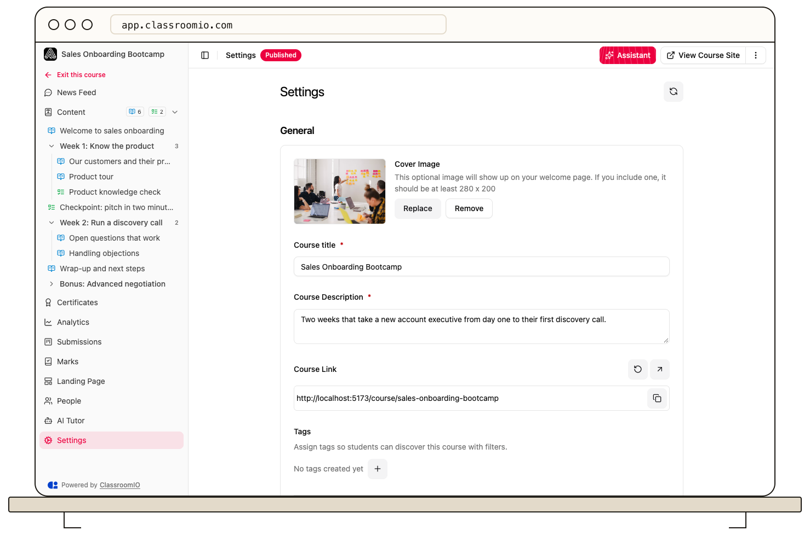

Open your course’s **Settings → General** to update its title, description, and cover image. Select **Save changes** to apply the edited details.

## Update the details

### 1. Open General settings

Open **Courses**, choose the course, and select **Settings**. In **General**, find **Course title**, **Course Description**, and **Cover Image**. Administrators and tutors with course access can edit these settings.

### 2. Edit the title and description

Enter the name students should recognize and a description that explains the course outcome. Both the title and description must contain text.

A course title and its link are separate values. Renaming the course does not mean you should generate a different course link; existing links may already have been shared.

### 3. Add or replace the cover

Use the cover image control to upload an image, **Replace** to choose another, or **Remove** to clear it. The interface recommends an image at least **280 × 200** pixels. Check that the important subject remains visible in the course's image crop.

Use an image you have permission to publish and avoid private information. This cover is used in course presentation; it is separate from adding an image inside a lesson note.

### 4. Save and check the result

Select **Save changes** in the settings action bar. Reopen the course card or course site to confirm the title, description, and cover look right. If the form reports an error, correct that field and save again.

Use **Discard** if you want to abandon the pending settings changes.

## Change other course information

Tags help students filter courses. The course landing-page editor controls the fuller public presentation. Use those dedicated areas rather than putting navigation instructions or enrollment rules into the short course description.

## Related guides

- [Organize courses with tags](/organization-and-team/manage-tags) — make courses easier to find
- [Set up your course landing page](/publish-and-brand/course-landingpage) — review the public course presentation
- [Publish a course and allow self-enrollment](/build-courses/publish-a-course-and-allow-self-enrollment) — make the finished course available
