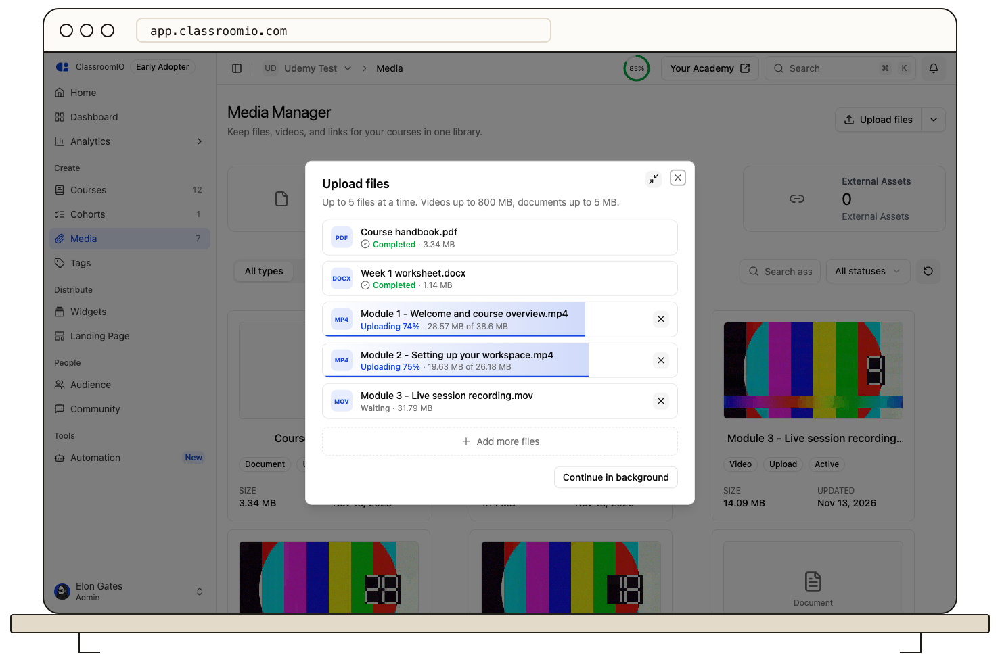
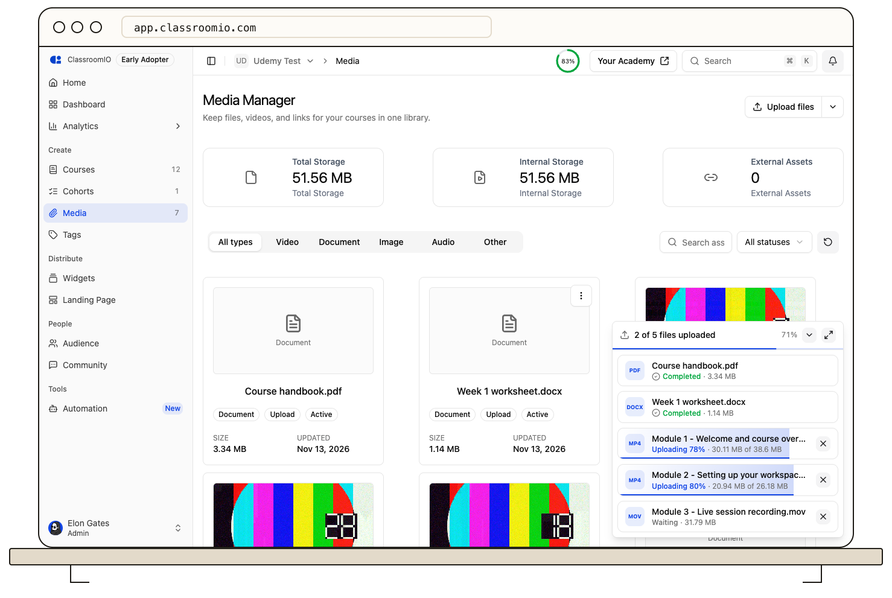
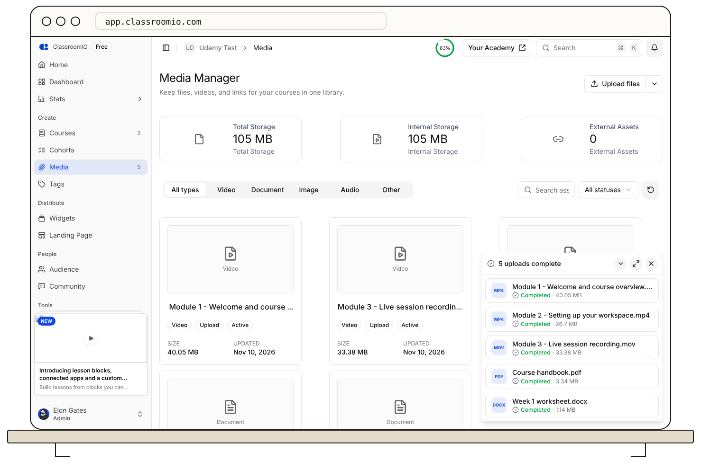

Open **Media** in the sidebar and select **Upload files**. Choose up to 5 videos or documents, then minimize the uploader and keep working: the uploads continue in the bottom-right corner of every dashboard page.

## Before you start

Uploading files requires a paid plan.

- **File types:** MP4, MOV, AVI, and MKV videos, and PDF, DOCX, DOC, CSV, XLSX, XLS, IPYNB, and PY documents.
- **How many:** up to 5 files can be in progress at a time. When one finishes, you can add another.
- **Size:** videos can be up to 1 GB each and documents up to 5 MB each. A self-hosted deployment can set different limits; the **Upload files** dialog shows the limits that apply to you.

Files uploaded here go to the media library only. They are not added to a lesson until you pick them from the **Library** tab of a video or document block.

## Upload the files

### 1. Open the uploader

Open **Media** in the sidebar and select **Upload files** to open the **Upload files** dialog.

### 2. Choose your files

Drag files into the upload area, or click it to browse. Each file appears in the list with its own progress bar, and up to 5 files upload at the same time. On ClassroomIO Cloud, your browser prepares each video before it uploads, so only 2 videos are prepared at once; other videos show **Waiting** until one finishes, and documents are not held back.

To stop one file, select **Remove file** (✕) on its row. Select **Add more files** under the list to add files while you still have room.

### 3. Minimize the uploader

Select **Minimize** in the corner of the dialog, or **Continue in background**. The dialog closes and the uploader moves to the bottom-right corner. Closing the dialog while files are uploading minimizes it too, so an upload is never cancelled by accident.

### 4. Keep working while files upload

Move between pages as usual. The minimized uploader stays in the corner and shows how many files have finished and the overall percentage.

- Select the arrow (**Hide files**) to shrink it to one line, and select it again (**Show files**) to see each file.
- Select the expand icon (**Open the upload window**) to return to the full dialog.

:::warning[Keep the tab open]
Uploads run in this browser tab. If you reload the page or close the tab while files are uploading, your browser asks you to confirm, and leaving cancels the files that have not finished. Switching to another organization also cancels them, after you confirm.
:::

### 5. Confirm the uploads finished

A finished file shows **Completed**, and the uploader's title changes to the number of uploads complete. Finished files appear on the **Media** page as they complete. Once nothing is still uploading, select **Close** on the minimized uploader, or **Done** in the dialog, to dismiss the list.

## If a file fails

A failed file shows **Failed** with the reason. Select **Try again** on its row to restart that file, or **Remove file** to drop it. The other files are not affected.

If a file is rejected before it starts, check its type and size against [Before you start](#before-you-start).

## Add a video link instead

To add a YouTube, Vimeo, or embed link to the library, open the arrow menu beside **Upload files** and select **Add a video link**.

## Related guides

- [Add or upload a video](/build-courses/add-or-upload-a-video) — add a library video to a lesson
- [Add documents and downloads](/build-courses/add-documents-and-downloads) — add a library document to a lesson
- [Troubleshoot video uploads and playback](/troubleshooting-and-reference/troubleshoot-video-uploads-and-playback) — check a failed upload or a video that will not play
