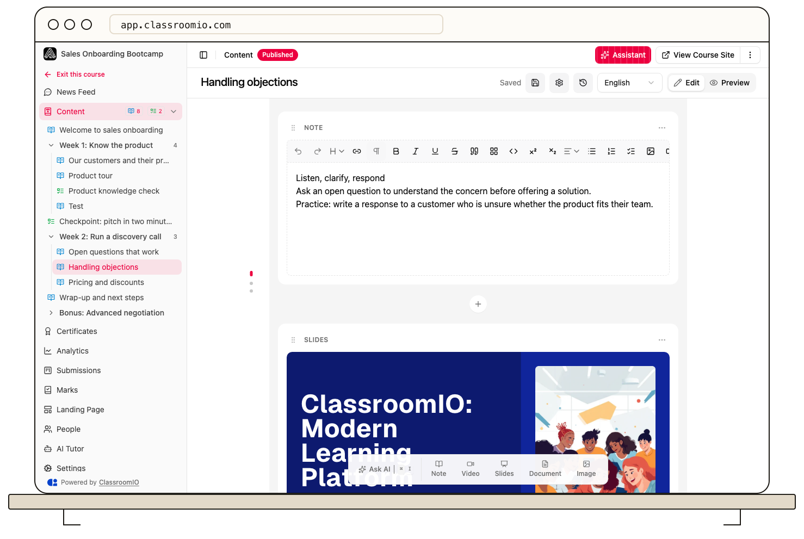

Open a lesson, select **Edit**, and add a **Note** block to write its text. Use the note's toolbar and slash menu to structure the content, then select **Preview** to check the saved result.

## Write and format the note

### 1. Add or open a note block

Open **Courses**, choose your course, and open a lesson from **Content**. Select **Edit**, then choose **Note** in the **Add content** row, or click into a note block the lesson already has. A new note block starts with example text; replace it with your own. Administrators and tutors with access to the course can edit lesson notes.

A lesson can have several note blocks. Use separate notes when you want a video, slide deck, image, or document to sit between two pieces of text.

If the lesson has multiple languages, select the settings icon in the lesson header and choose the language at the top of **Lesson settings** before changing the text. Each language has its own note content.

### 2. Structure the content

Type or paste your text in the editor. Use the toolbar for headings, bold or italic text, lists, links, and tables. Type `/` inside the note to open the insert menu and choose an item, such as a table or code block.

Use headings to break up the lesson and ordered lists for steps students should follow. Give links descriptive text and check that their destinations are accessible to your students.

For equations, see [Add math and LaTeX](/create-and-deliver/use-math-in-editor). Add videos, slide decks, images, and downloadable files as their own blocks from **Add content** rather than pasting them into the note.

### 3. Save and inspect the result

Note text saves shortly after you stop typing. The **Saved** label in the lesson header covers the lesson title and settings, not note text, so select **Preview** to read the lesson as students see it and confirm your changes appear. Review pasted formatting, links, and spacing there.

Saved changes update the lesson; they are not a separate unpublished draft. Take care when editing material in a course students already use.

## Recover a previous note

Local draft recovery can help after an interrupted edit in the same browser. **Version history** lets you review and restore saved note versions for the selected language. See [Recover drafts and use version history](/build-courses/recover-drafts-and-use-version-history) before restoring over newer work.

## Related guides

- [Create and edit a lesson](/build-courses/create-and-edit-a-lesson) — add and arrange lesson blocks
- [Add math and LaTeX](/create-and-deliver/use-math-in-editor) — insert inline or block equations
- [Add documents and downloads](/build-courses/add-documents-and-downloads) — add files instead of pasting their contents
