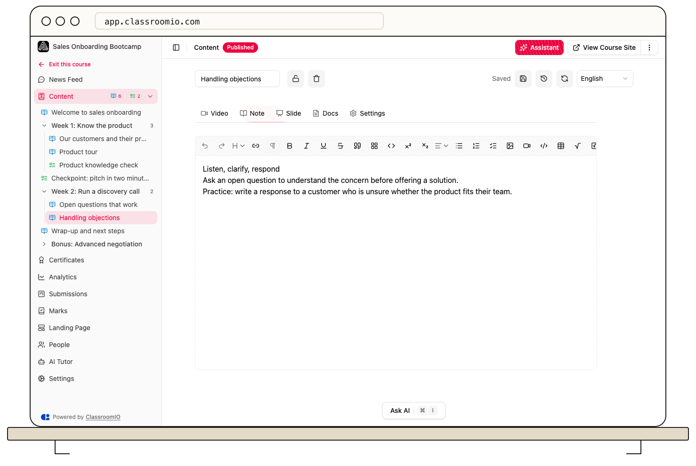

Open a lesson, select **Edit**, and choose **Note** to write its main text. Use the editor toolbar and slash menu to structure the content, then check the saved result in view mode.

## Write and format the note

### 1. Open the Note editor

Open **Courses**, choose your course, and open a lesson from **Content**. Select **Edit**, then **Note**. Administrators and tutors with access to the course can edit lesson notes.

If the lesson has multiple languages, choose the language you intend to edit before changing the text. Each language has its own note content.

### 2. Structure the content

Type or paste your text in the editor. Use the toolbar for headings, bold or italic text, lists, links, and tables. Type `/` to open the insert menu and choose an available block.

Use headings to break up the lesson and ordered lists for steps students should follow. Give links descriptive text and check that their destinations are accessible to your students.

For equations, see [Add math and LaTeX](/create-and-deliver/use-math-in-editor). Put video, slide decks, and downloadable files in their dedicated material tabs when that is the resource students need.

### 3. Save and inspect the result

Changes autosave after a pause in typing. Check the **Saved** indicator, then use the save control to return to the reading view. Review pasted formatting, links, and spacing there.

Saved changes update the lesson; they are not a separate unpublished draft. Take care when editing material in a course students already use.

## Recover a previous note

Local draft recovery can help after an interrupted edit in the same browser. **Version history** lets you review and restore saved note versions for the selected language. See [Recover drafts and use version history](/build-courses/recover-drafts-and-use-version-history) before restoring over newer work.

## Related guides

- [Create and edit a lesson](/build-courses/create-and-edit-a-lesson) — add teaching materials
- [Add math and LaTeX](/create-and-deliver/use-math-in-editor) — insert inline or block equations
- [Add documents and downloads](/build-courses/add-documents-and-downloads) — attach files instead of pasting their contents
