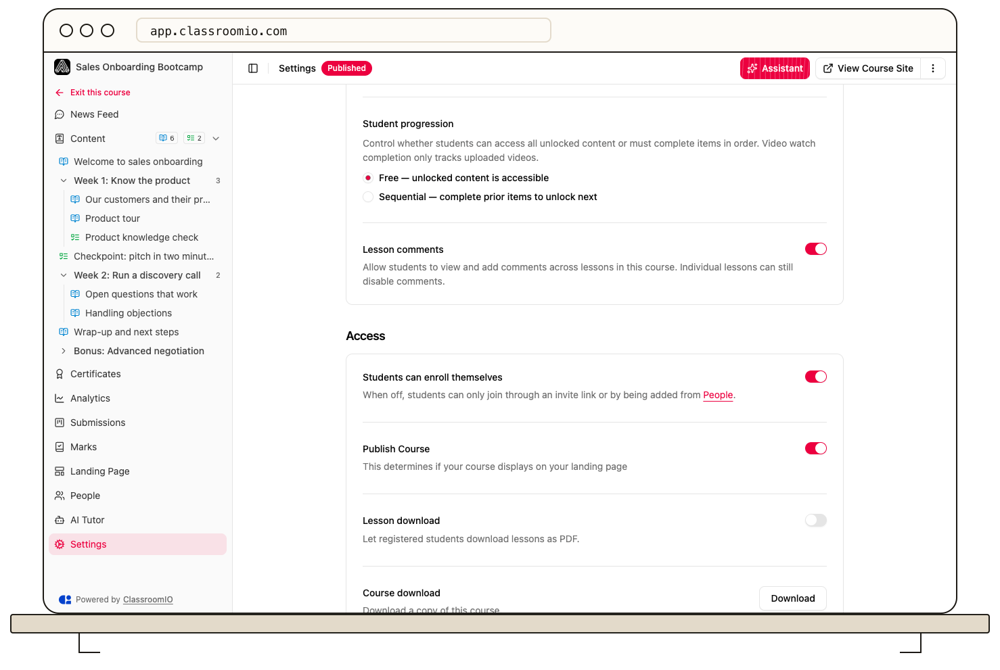

Use **Student progression** to let students open unlocked content freely or require them to complete earlier items first. Set completion rules on each lesson and exercise to define what counts as finished.

## Choose the course progression mode

1. Open the course's **Settings → Content**.
2. Under **Student progression**, choose **Free — unlocked content is accessible** or **Sequential — complete prior items to unlock next**.
3. Select **Save changes**.

Administrators and tutors with course access can change these settings. Free progression allows access in any order; it does not change each lesson's completion rule. Sequential progression uses the saved course outline, so review [lesson and exercise order](/build-courses/create-and-reorder-lessons-and-exercises) before enabling it.

Content grouping is a separate presentation choice. Showing sections does not itself require students to follow a sequence.

## Set lesson completion

Open the lesson, select **Edit**, and open **Settings**. Choose **Completion rule**:

- **Manual**: the student marks the lesson complete.
- **Video watch**: completion depends on watching the configured videos to the **Watch threshold (%)**.
- **None**: the lesson does not block progression.

Save the lesson and check the saved settings.

:::warning[Use uploaded video for watch completion]
Video-watch tracking only works for uploaded video. External sources such as YouTube and Vimeo cannot meet that tracked requirement. For a lesson using only embeds, choose Manual or upload the required video so students can complete the lesson.
:::

When video-watch completion is active, skipping ahead is restricted and playback pauses when the student switches tabs. Check your video selection and threshold with a demo student before releasing the lesson.

## Set exercise completion

Open the exercise's **Settings** and choose its **Completion rule**:

- **Submitted**: completion follows submission.
- **Passed**: completion requires the **Pass threshold (%)** you set.

If students must pass, review **Allow multiple attempts** so a failed attempt does not leave them without a route forward. Questions requiring instructor review can leave completion waiting for a grade. Review the warning before saving a passing requirement, especially for an exercise with existing submissions.

## Keep availability and certificates separate

A content lock is different from a progression prerequisite. Publishing the course does not unlock every lesson or exercise. Review individual locks in **Content** before diagnosing a student who cannot continue.

Certificates require 100% course completion: every lesson and exercise. Review any final exercise score requirement and the [certificate rules](/create-and-deliver/certificates) separately.

## Verify as a student

Use a separately enrolled demo student to complete the actual sequence. Check the first item, the next-item unlock, a failed exercise attempt, and the final completion result. Administrator access can bypass the restrictions you are trying to test.

Public courses use an anonymous learning experience. Test those courses on their signed-out public pages instead of assuming the enrolled-student rules apply identically.

## Related guides

- [Create and reorder lessons and exercises](/build-courses/create-and-reorder-lessons-and-exercises) — set the sequence used by progression
- [Add or upload a video](/build-courses/add-or-upload-a-video) — choose a source suitable for watch tracking
- [Set answers, points, and automatic grading](/build-courses/set-answers-points-and-automatic-grading) — make passing requirements meaningful
- [Create certificates](/create-and-deliver/certificates) — configure the completion reward
