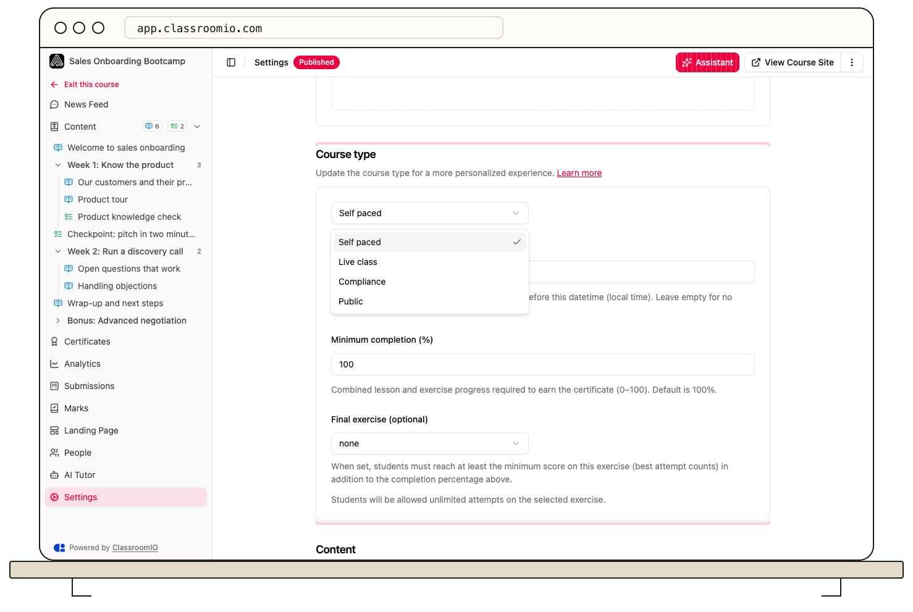

Choose a course type based on access and delivery: self-paced study, instructor-led classes, required compliance training, or public content without sign-in. Course type does not replace your publishing, content-lock, or completion settings.

## Choose your delivery model

### Self paced

Use **Self Paced** for enrolled students working on their own schedule. Combine lesson materials and exercises, then choose free or sequential progression. It is also the initial type for courses created from the Home AI prompt.

[Create a self-paced course](/build-courses/create-a-self-paced-course) when students need an LMS course without a required live timetable.

### Live class

Use **Live Class** for instructor-led delivery. Schedule live sessions on lessons, provide the meeting links, and configure reminder emails. Selecting the type does not create a video meeting or session time.

Grading depends on the exercise's question types and settings. Selecting Live class does not by itself make every question manually graded.

[Create a live class course](/build-courses/create-a-live-class-course), then [schedule the sessions](/create-and-deliver/live-class).

### Compliance

Use **Compliance** for required training with completion tracking, deadlines, and recurring training rules. Set the completion deadline before publishing and enrolling students. Review each exercise’s passing requirements and the course’s retake settings. Certificates require every lesson and exercise to be completed.

Enrollment and completion are separate: a student can appear in **People** while their compliance status is still **Not started**.

[Create a compliance course](/build-courses/create-a-compliance-course) before assigning mandatory training.

### Public

Use **Public** for unlocked lessons and exercises visitors can access without an account. Exercises are restricted to automatically graded question types and score in the browser. Public courses do not use the normal enrolled-student LMS workflow.

Use another type when you need managed enrollment, tracked student submissions, or instructor-reviewed answers. [Create a public course](/build-courses/create-a-public-course) for open learning material.

## Set or change the type

When creating a blank course, choose the type before entering its name and description. For an existing course, open **Settings → Course type**, select a value, and select **Save changes**.

:::warning[Review access before switching]
Changing an existing course's type can change access, completion behavior, and available tools. Switching to Public requires replacing or removing questions that cannot be automatically graded. Review existing students and content before saving.
:::

After a type change, inspect the settings and test the actual student or public experience. An administrator's access does not prove how the course behaves for visitors or enrolled students.

## Related guides

- [Create a course from scratch](/build-courses/create-a-course-from-scratch) — start with an empty course
- [Control progression and completion](/create-and-deliver/course-progression) — choose when students can continue
- [Publish a course and allow self-enrollment](/build-courses/publish-a-course-and-allow-self-enrollment) — make the finished course available
