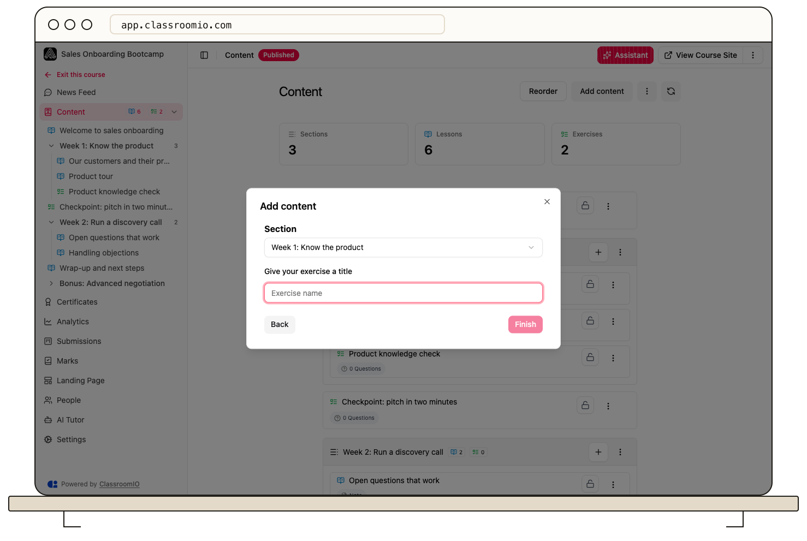

Create an exercise from your course’s **Content → Add content** control. Add questions, answer keys, and points, then save and preview the assessment before students use it.

## Create the exercise

### 1. Open Add content

Open **Courses**, choose your course, and select **Content**. Select **Add content**, choose **Exercise**, and select **Continue**. To put it in a section, use that section's add control instead. Administrators and tutors with course access can create exercises; a lesson is not required first.

### 2. Choose a starting point

Select **From Scratch**, then **Next**. Enter the exercise title and select **Finish**. For prepared questions, select **Use a Template** instead and choose a template.

**Use AI** in this dialog is marked **Coming soon**. For other starting methods, see [Create an exercise with AI or a template](/build-courses/create-an-exercise-with-ai-or-a-template).

### 3. Add instructions and questions

Open the exercise and select **Questions**. Update its title and instructions, then select **Add question**. Choose the question type, write the question, and configure the response options and correct answers where supported. Set the point value for each question.

Use the menu beside **Add question** to add question sections when the assessment needs separate groups. These are different from sections in the course outline.

See [question types](/build-courses/choose-an-exercise-question-type) and [answers, points, and grading](/build-courses/set-answers-points-and-automatic-grading) for the scoring requirements.

### 4. Save and check the result

Select **Save**, resolve any validation errors, then select **Preview**. Return with **Edit** if you need changes. Reordering questions and editing answers require saving the exercise.

## Set completion and availability

Open the exercise's **Settings** to choose whether students may make multiple attempts, and whether completion requires submission or passing. Set the passing threshold when needed and save the settings.

Check the exercise's lock state in **Content**. Publishing the course does not unlock a locked exercise, and sequential progression may require earlier work first.

Test the saved exercise with an enrolled demo student before sharing it. For a public course, test the signed-out public exercise instead.

## Notify enrolled students

When the saved exercise is ready and available, open its more-actions menu and select **Notify students** if you want to email enrolled students a link. This sends real email, so check the content and recipients before using it. Watch the progress indicator for the send result.

## Related guides

- [Set answers, points, and automatic grading](/build-courses/set-answers-points-and-automatic-grading) — configure scoring before students submit
- [Reorder exercise questions](/build-courses/reorder-exercise-questions) — arrange the assessment
- [Preview an exercise before publishing](/build-courses/preview-an-exercise-before-publishing) — test layout and student access
- [Control progression and completion](/create-and-deliver/course-progression) — choose when students can continue
