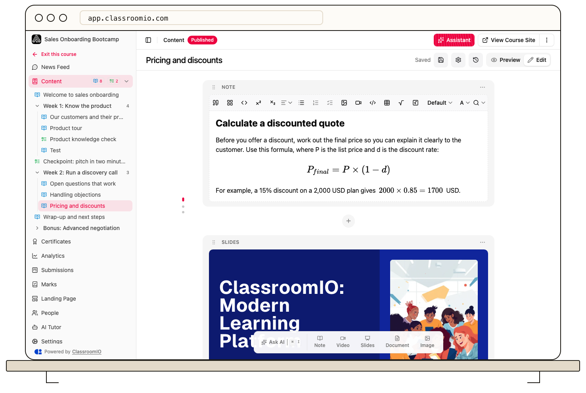

Use **Inline Expression** for math within a sentence and **Block Expression** for a standalone equation in a lesson's note block. ClassroomIO renders each expression so students see formatted math.

## Open a note block

Open your course's **Content**, select a lesson, and choose **Edit**. Click into an existing note block, or choose **Note** in the **Add content** row to add one. Administrators and tutors with course editing access can add math to lesson notes.

## Insert inline math

Type a LaTeX expression between double dollar signs, such as `$$x^2$$`, to convert it into inline math. You can also use **Inline Expression** in the note's toolbar; scroll the toolbar sideways if the math buttons are out of view. If text is selected, the editor uses it as the expression's LaTeX.

Use inline math for expressions that belong in the surrounding sentence.

## Insert a block equation

Use **Block Expression** in the toolbar, or type `/` and choose **Block Expression** under **Insert**. The editor inserts a sample expression; click it to replace it with your equation.

For example, `\frac{a}{b}` produces a fraction, while `a^2 + b^2 = c^2` uses superscripts. Type, write or paste the math rather than pasting an image of an equation when students need clear, scalable math.

## Edit an expression

Click an existing inline or block expression. A popover opens on the **Type** tab, where you write math directly: `x^2` becomes a superscript and `1/2` a fraction. The buttons above the field insert structures that are hard to type, such as fractions, roots, matrices, systems of equations, integrals and limits. On touch devices a math keyboard appears.

To write LaTeX instead, open the **LaTeX** tab, which shows the LaTeX field and a live **Preview**. If the preview shows an error, check the braces and command spelling.

Select **Done**, press Enter, or click outside the popover to save. Select **Cancel** or press Escape to discard your changes. Saving an empty expression removes it.

## Paste equations

Paste math from elsewhere and it becomes editable math: LaTeX between `$…$`, `$$…$$`, `\(…\)` or `\[…\]`, equations copied from Microsoft Word, and math copied from web pages that use MathML, such as Wikipedia or sites built with KaTeX or MathJax. A pasted `$x$` becomes inline math, even though typing inline math in a note still needs double dollar signs.

## Math in question titles and options

Exercise question titles and answer options are one-line fields that accept math. Type an expression between single dollar signs, such as `$x^2$`, and it becomes a formula. Select the √ button at the end of the field, or click a formula, to open the same math popover, with **Type** and **LaTeX** tabs. Pasted LaTeX, MathML and Word equations also become formulas. Write `\$` for a literal dollar sign; a lone amount such as `$5` stays plain text. Students see the formatted math when they take and review the exercise.

Accepted answers stay plain text, because students type their answers without dollar signs.

## Save and check the reading view

Select **Preview** and confirm the equations appear in the note. Check a narrow viewport as well if the lesson contains long equations. Keep an explanation in the surrounding prose so the mathematical result has context.

Math formatting does not calculate or grade an exercise answer. Configure an exercise's answer key separately when students need to submit a response.

## Related guides

- [Write lesson content in the editor](/build-courses/write-lesson-content-in-the-editor) — format your note blocks
- [Create and edit a lesson](/build-courses/create-and-edit-a-lesson) — add and arrange lesson blocks
- [Set answers, points, and automatic grading](/build-courses/set-answers-points-and-automatic-grading) — configure scoring before students submit
