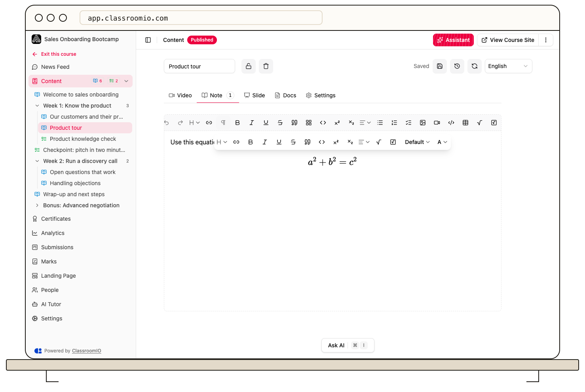

Use **Inline Expression** for math within a sentence and **Block Expression** for a standalone equation in the lesson editor. ClassroomIO renders the LaTeX expression so students see formatted math.

## Open the lesson editor

Open your course's **Content**, select a lesson, choose **Edit**, and open **Note**. Administrators and tutors with course editing access can add math to lesson notes.

## Insert inline math

Type a LaTeX expression between double dollar signs, such as `$$x^2$$`, to convert it into inline math. You can also use **Inline Expression** in the toolbar. If text is selected, the editor uses it as the expression's LaTeX.

Use inline math for expressions that belong in the surrounding sentence.

## Insert a block equation

Use **Block Expression** in the toolbar, or type `/` and choose **Math → Block Expression**. Replace the initial expression with your equation.

For example, `\frac{a}{b}` produces a fraction, while `a^2 + b^2 = c^2` uses superscripts. Enter LaTeX in the expression editor rather than pasting an image of an equation when students need clear, scalable math.

## Edit an expression

Select an existing inline or block expression. Update the LaTeX in the prompt and confirm to render it again. If the result is incorrect, reopen the expression and check its braces and command spelling.

## Save and check the reading view

Check the lesson's **Saved** indicator, then leave edit mode and review the equations in the note. Check a narrow viewport as well if the lesson contains long equations. Keep an explanation in the surrounding prose so the mathematical result has context.

Math formatting does not calculate or grade an exercise answer. Configure an exercise's answer key separately when students need to submit a response.

## Related guides

- [Write lesson content in the editor](/build-courses/write-lesson-content-in-the-editor) — format your lesson notes
- [Create and edit a lesson](/build-courses/create-and-edit-a-lesson) — add teaching materials
- [Set answers, points, and automatic grading](/build-courses/set-answers-points-and-automatic-grading) — configure scoring before students submit
