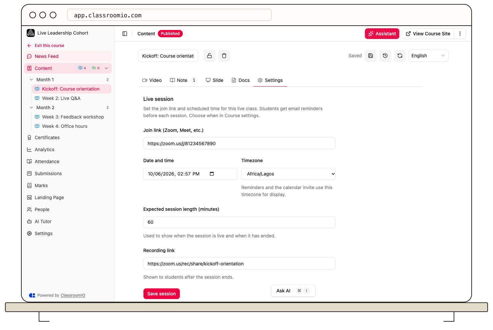

A live class session is configured on its lesson. Change the session there so the student join button, reminders, and calendar event use the new details.

1. Open the live class course, then open the lesson that hosts the session.
2. In **Settings → Live session**, edit **Join link (Zoom, Meet, etc.)**, **Date and time**, or **Timezone**.
3. Choose **Save session**.
4. If students are already enrolled, confirm **Save and notify** when you want them to receive the updated details and calendar invitation.

The updated invitation refers to the same calendar event, so it updates an event the student already added. Check the lesson after saving to confirm the intended time and link. See [Run a Live Class](/create-and-deliver/live-class) for the initial scheduling steps.
