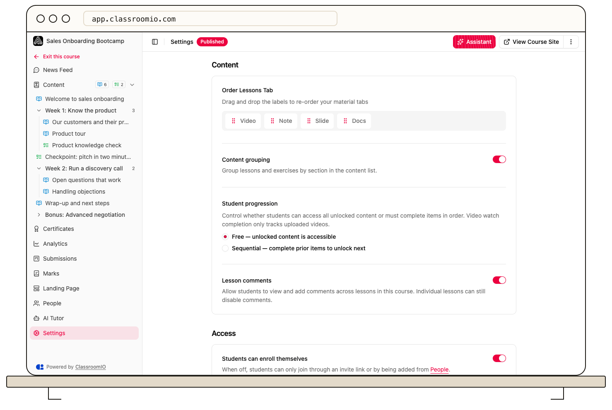

Set **Student progression** to **Free** when students should open unlocked content in any order, or **Sequential** when they must complete prior items to unlock the next. The setting applies to the course outline; each item keeps its own completion rule.

## Change the progression mode

1. Open the course and select **Settings → Content**.
2. Under **Student progression**, select **Free — unlocked content is accessible** or **Sequential — complete prior items to unlock next**.
3. Select **Save changes**.

Administrators and tutors with course access can change the mode. Before choosing **Sequential**, check the order of [lessons and exercises](/build-courses/create-and-reorder-lessons-and-exercises). A student who cannot complete an earlier item may be unable to open later content.

Progression does not remove individual content locks or change lesson and exercise completion rules. Test the sequence with a separately enrolled demo student; administrator access can bypass the restriction.

## Related guides

- [Control progression and completion](/create-and-deliver/course-progression) — understand how the settings work together
- [Understand locked course content](/deliver-and-engage/understand-locked-course-content) — diagnose a blocked student
- [Set lesson completion rules](/deliver-and-engage/set-lesson-completion-rules) — define when a lesson counts as finished
