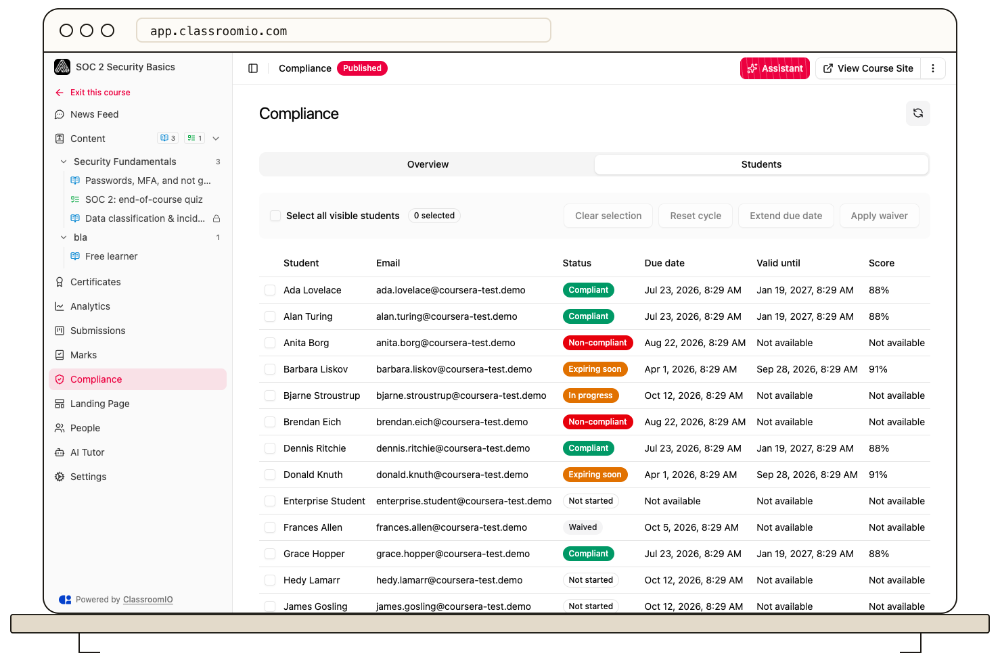

Compliance training repeats in cycles. When a student's completed training reaches its **Valid until** date, ClassroomIO creates a new cycle and the student can complete the course again.

The current default renewal period is 12 months. The default passing score is 80%, and reminder emails are scheduled 30, 7, and 1 days before the due date. There is no recurrence interval control in the course settings screen today.

## Check an individual renewal

1. Open the compliance course and select **Compliance**.
2. Choose **Students** and find the student.
3. Check the current status, due date, and **Valid until** date. Students can compare **Current cycle** with **Past cycles** in their own course view.

If someone needs a different due date for the active cycle, select the student and use **Extend due date**. You can also [reset or waive a cycle](/deliver-and-engage/manage-active-compliance-cycles) when appropriate.
