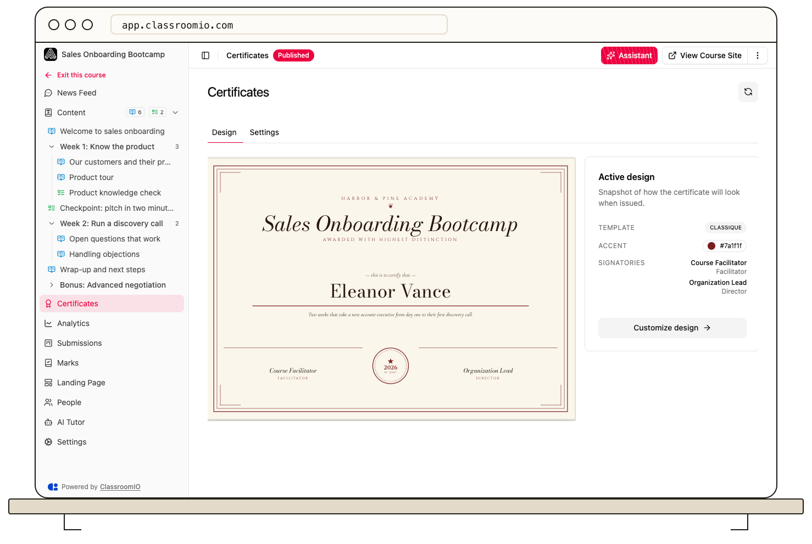

Design the certificate on the course's **Certificates → Design** tab. The preview lets you check the template and color before students download the document.

:::info[Paid plan required]
Certificate editing requires a paid plan. The controls are disabled on the Free plan.
:::

## Customize the design

1. Open the course and select **Certificates**. It opens on **Design**.
2. Select **Customize design** to open the editor.
3. Choose a **Template** and accent color while checking the live preview.
4. If the document needs signatures, fill in the [signatory fields](/deliver-and-engage/add-certificate-signatories).
5. Optionally set a **Certificate ID format**, then save the design.

:::warning[Changes affect later downloads]
ClassroomIO generates a certificate from the course's current design each time it is downloaded. Changing the template, color, or signatories also changes later downloads for students who earned their certificates earlier. Review the preview before saving changes.
:::

The design does not decide who qualifies. Students must complete every lesson and exercise, including any passing rules, before the optional course completion deadline. Set these rules in the course and exercise **Settings** tabs.

## Related guides

- [Add certificate signatories](/deliver-and-engage/add-certificate-signatories) — include names, roles, and signatures
- [Set certificate eligibility rules](/deliver-and-engage/set-certificate-eligibility-rules) — decide when a certificate is issued
- [Create certificates](/create-and-deliver/certificates) — review design, rules, and download together
