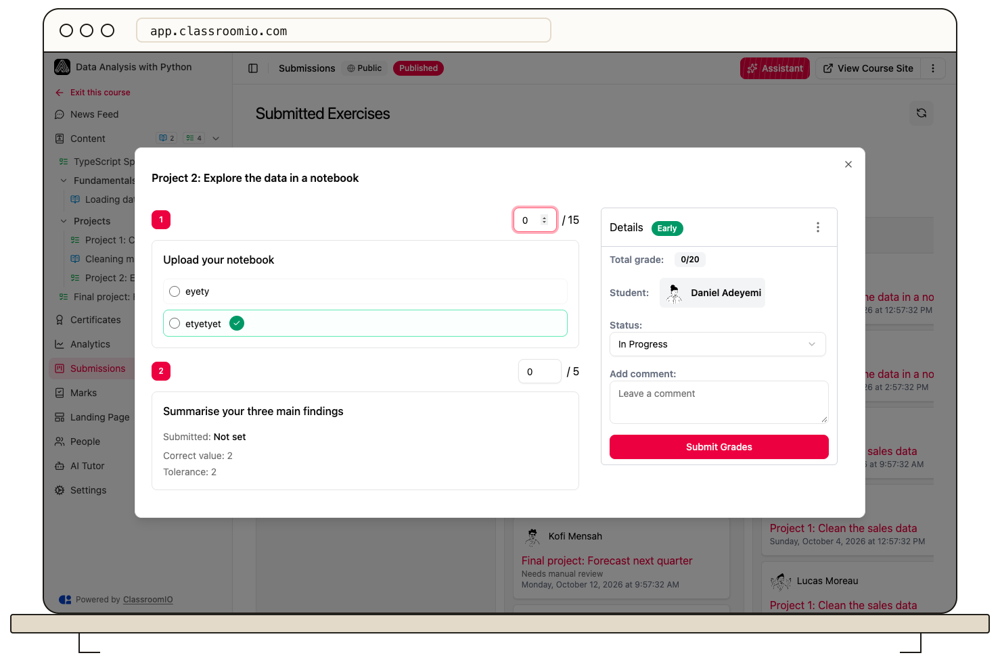

The course submission screen does not currently offer an active **Grade with AI** action. Grade submissions manually, then submit the final scores and feedback.

1. Open the course's **Submissions** tab.
2. Select the exercise title on a submission card to open the grading view.
3. Review each answer and enter the appropriate score and feedback.
4. Select **Submit Grades** to record the result.

Objective questions can receive automatic scores according to the exercise's answer settings. Open-ended answers still need a reviewer. For the full procedure, see [Grade an exercise](/create-and-deliver/grade-exercise).
