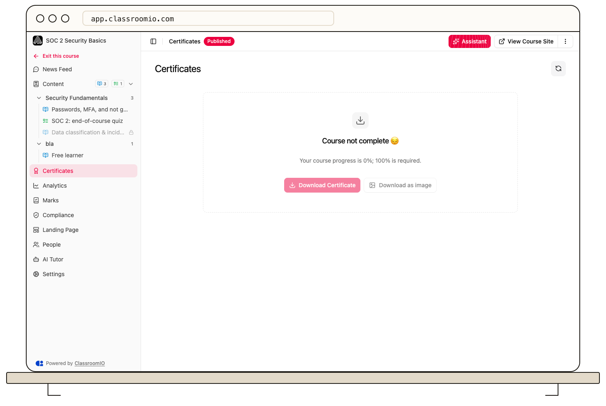

First confirm that the student met the course's certificate rules and that **Allow students download certificate** is on. An eligible student can then open the course's **Certificates** tab in the learning area and download the document.

## Check eligibility

Open the course's **Settings** and review **Student progression** and any **Course Completion Deadline**. The student must complete every lesson and exercise in either progression mode. For an exercise with a **Passed** completion rule, compare the student's best graded attempt with that exercise's **Pass threshold (%)**. An answer still awaiting instructor review may not count as complete yet.

Certificate features require a paid plan. If the organization is on the Free plan, the certificate controls are disabled and no new certificate can be issued.

## Check download access

Open **Certificates → Settings** on the course and turn on **Allow students download certificate**, then save. A student may have earned a certificate record while downloads were off; enabling the setting lets eligible students download it.

Ask the student to reopen the course, select **Certificates**, and use the download control. If the button opens but no file appears, ask them to check their browser's download permission and Downloads folder. Do not ask them to send private student records through a public support channel.

## Related guides

- [Set certificate eligibility rules](/deliver-and-engage/set-certificate-eligibility-rules) — verify the requirements
- [Create certificates](/create-and-deliver/certificates) — find the course settings and student view
