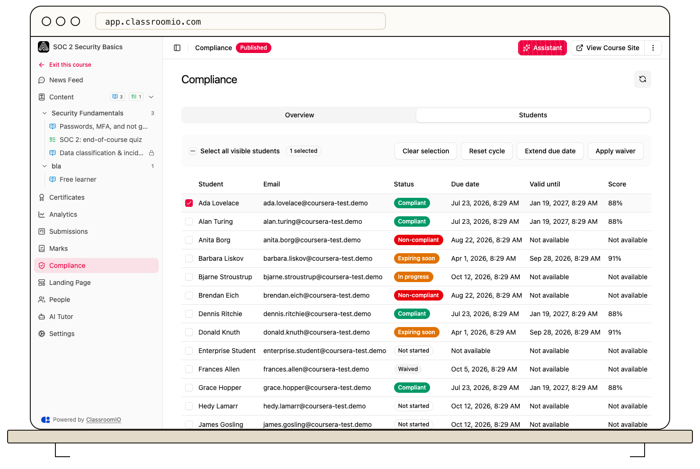

Use the **Students** tab of a compliance course to manage exceptions for the current training cycle.

1. Open **Courses**, choose the compliance course, then select **Compliance → Students**.
2. Select one or more students.
3. Choose **Reset cycle**, **Extend due date**, or **Apply waiver** and confirm the action.

**Reset cycle** starts the current assignment over. It clears that cycle's completion, score, attempts, and waiver, so check the selection before confirming. **Extend due date** changes the deadline for an incomplete cycle; completed students are skipped. **Apply waiver** excuses an incomplete cycle and can include a reason and expiration date. Completed students are skipped.

Review the resulting status and due date in the student list. Students can review **Past cycles** in their own [compliance history](/deliver-and-engage/review-learner-compliance-history). The staff table shows the current cycle.
