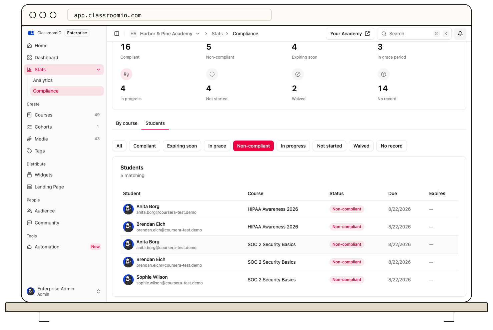

The organization compliance report brings current training statuses together across your compliance courses.

1. Open the organization dashboard and choose **Compliance**.
2. Review the summary counts to see how many students are compliant, in progress, expiring soon, in grace period, or non-compliant.
3. Choose **By course** to compare assignments across courses, or **Students** to inspect individual records.
4. Filter by status to focus on the people who need follow-up. Use **Export** when you need a copy outside ClassroomIO.

Status reflects each student's current cycle. The course's **Compliance → Students** tab shows current due dates and validity dates; students can see their own earlier cycles under **Past cycles**. See [Report on compliance status](/analytics-and-reporting/report-on-compliance-status) for a fuller walkthrough.
