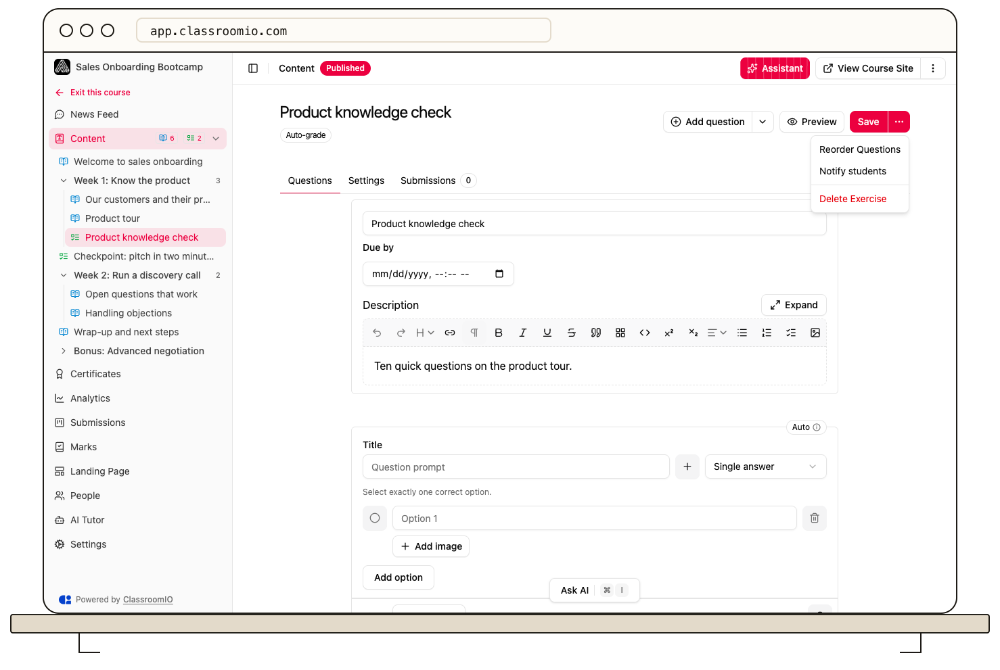

Use **Notify students** on an exercise to email enrolled students a direct link to it. The action starts sending immediately; there is no recipient or message editor in this flow.

:::warning[Selecting Notify students sends an email]
The action targets enrolled students with email addresses who allow this notification. Selecting it again starts another send, so check that you have the right course and exercise first.
:::

## Send the notification

1. Open the course and select the exercise.
2. In the exercise's **More** menu, select **Notify students**.
3. Watch the notification at the bottom of the screen. It first says **Notifying students…**, then **Notified N students** or **Couldn't notify students**.

The email includes the course and exercise names and a link to take the exercise. For a public course, the link uses its public course page; for other course types, it uses the signed-in learning area. The count confirms how many email sends were queued, not that every recipient has opened the message.

If the count is lower than expected, check course enrollment, student email addresses, and notification preferences. If sending fails, wait for the error state before trying again to avoid duplicate messages.

## Related guides

- [Create an exercise](/create-and-deliver/create-exercise) — prepare the work before notifying students
- [Troubleshoot invitation and notification emails](/troubleshooting-and-reference/troubleshoot-invitation-and-notification-emails) — diagnose missing messages
