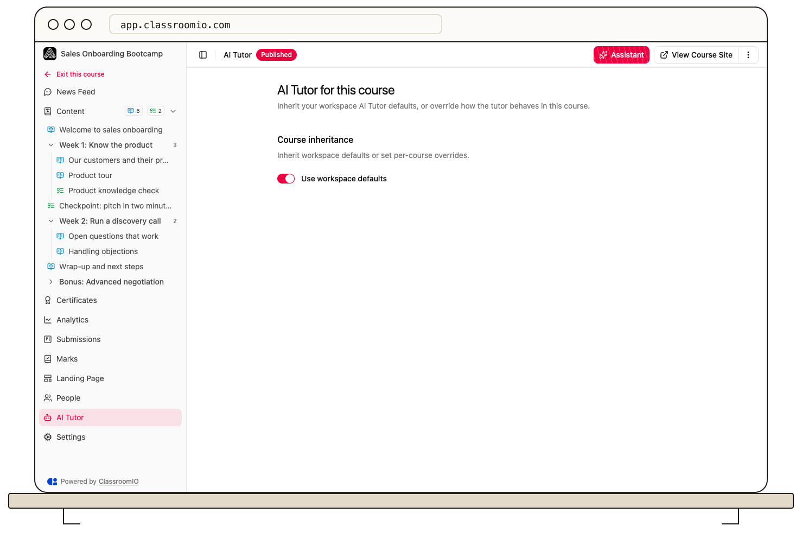

A course uses the organization's AI Tutor defaults while **Use workspace defaults** is on. Turn that switch off to configure the tutor for this course alone.

## Set a course override

1. Open the course and select **AI Tutor** in its sidebar.
2. Under **Course inheritance**, turn off **Use workspace defaults**.
3. Set availability, persona, response length, guidance, assessment behavior, grounding, citations, and escalation for this course.
4. Select **Save changes** in the bottom action bar.

To restore inheritance, turn **Use workspace defaults** on and save. The course then follows later changes to the organization defaults. Use **Discard** if you want to abandon an unsaved draft.

Changes affect future tutor behavior in this course. Test with a demo student, especially if the override changes the help allowed during exercises. Students may see a capacity message if their monthly tutor limit or your organization's AI capacity is exhausted.

## Related guides

- [Set organization-wide AI Tutor defaults](/deliver-and-engage/set-organization-wide-ai-tutor-defaults) — edit inherited settings
- [Use AI Tutor as a student](/deliver-and-engage/use-ai-tutor-as-a-learner) — verify the result
