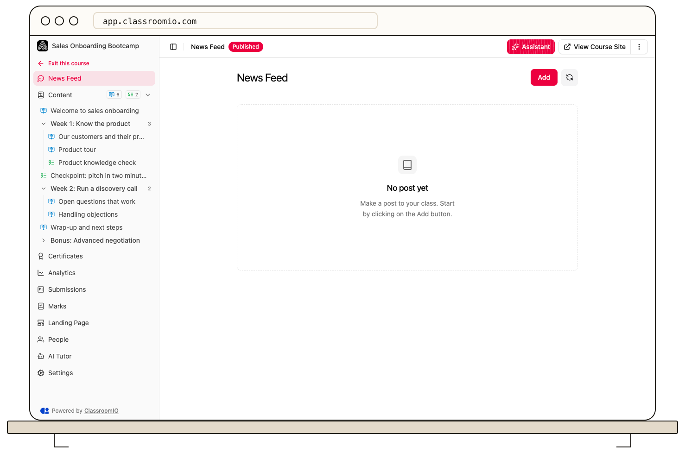

A course **News Feed** lets instructors share updates with enrolled students. Your organization must have Newsfeed enabled for students to see it.

1. Open the course and choose **News Feed**.
2. Select **Add** on an empty News Feed, or **Make a post** when posts already exist. Write your announcement and select **Post**.
3. Use the post menu to edit, pin, unpin, or delete the post. Pinned posts appear above newer unpinned posts.

Students can react and comment on visible posts. A News Feed post is a course update; the post editor does not have a separate email notification option. For a direct exercise email, use [Notify students about an exercise](/deliver-and-engage/notify-learners-about-an-exercise). To show Newsfeed to students, see [Show course newsfeeds and grading](/publish-and-brand/show-course-news-feeds-and-grading).
