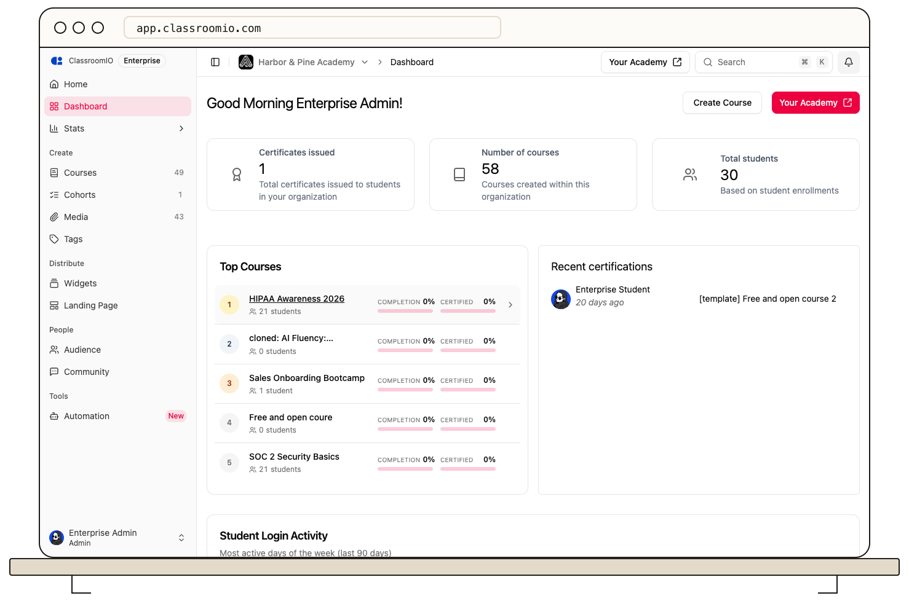

Use the organization dashboard to check recent certificate activity. Its **Certificates issued** figure gives an overview, and **Recent certifications** lists the latest awards.

To investigate a particular award, open the course and choose **Certificates**. You can review its certificate settings and the student's eligibility there. A student who qualifies can open the same course area to [download their certificate](/deliver-and-engage/help-a-learner-download-a-certificate).

The dashboard is a recent activity view; it does not provide a dedicated certificate report with filters or an export control. For completion and grade records, use [course analytics](/analytics-and-reporting/review-course-performance-and-learner-progress) and [marks](/deliver-and-engage/view-and-export-marks).
