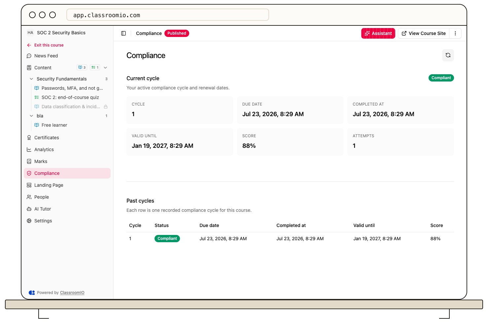

As a student, open a compliance course and choose **Compliance** to see your current training status and recorded cycles.

1. Open the assigned compliance course.
2. Choose **Compliance** in the course navigation.
3. Review **Current cycle** for your status, due date, completion date, validity date, and score.
4. Scroll to **Past cycles** to compare recorded cycle numbers and outcomes. The table can include the current recorded cycle.

A new cycle can begin after an earlier completion expires. The staff **Compliance → Students** table shows each student's current status, due date, validity, and score; it does not open the student's full cycle history. If you need help understanding a status, contact your course administrator. See [Understand compliance courses](/deliver-and-engage/understand-compliance-courses).
