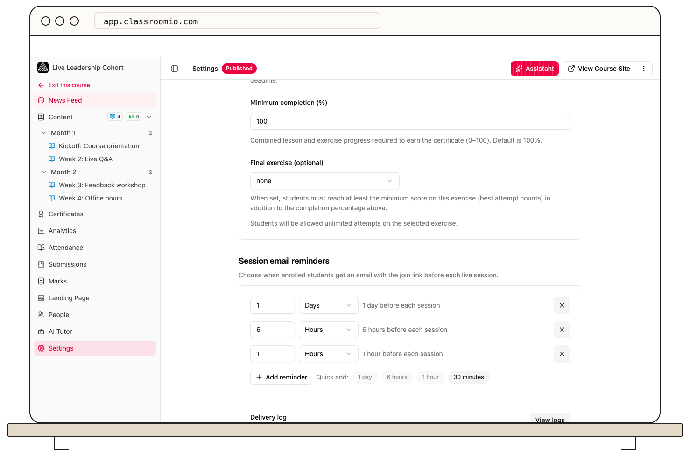

ClassroomIO sends enrolled students live session details and a calendar invitation. The session's **Timezone** determines the time shown in those messages.

## Set up the session and reminders

1. Open the live class lesson's **Settings → Live session**.
2. Enter the join link, date and time, and timezone, then choose **Save session**.
3. Open the course's **Settings → Session email reminders** to review or change the reminder schedule.
4. Save the course settings. Use the delivery log in that section to check reminder sends.

Students receive an invitation for the next session when they enroll. Scheduled reminder emails include the join link; the default schedule includes reminders about 24 hours and 1 hour before the session. If you change a scheduled session, choose **Save and notify** to send its new details to enrolled students. See [Change a live class time or join link](/deliver-and-engage/change-a-live-class-time-or-join-link).
