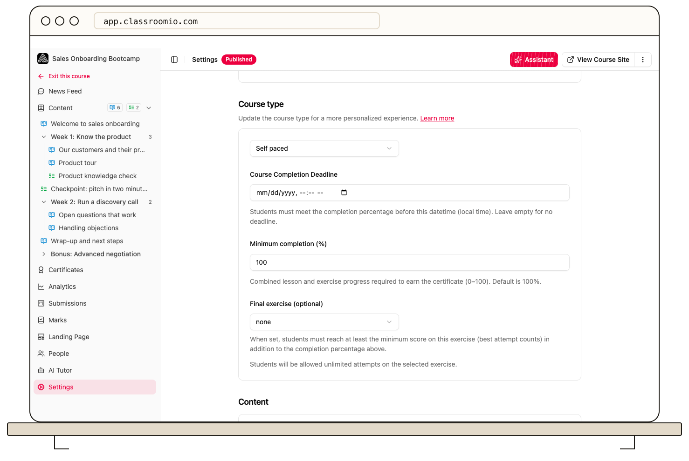

ClassroomIO issues a certificate after a student completes every lesson and exercise in the course, provided any course completion deadline has not passed. An exercise with a **Passed** completion rule also requires a passing grade.

:::info[Paid plan required]
Certificate controls are visible but disabled on the Free plan.
:::

## Set the requirements

1. Open the course's **Settings** tab and find **Completion rules**.
2. Choose **Free** or **Sequential** under **Student progression**. Both modes require every lesson and exercise to be complete for certification.
3. To require a passing grade, open the exercise's **Settings**, choose the **Passed** completion rule, and set its **Pass threshold (%)**. Review **Allow multiple attempts** there if students should be able to retry.
4. If completion must happen by a certain time, set **Course Completion Deadline**. The student's local time is used; finishing exactly at the deadline qualifies.
5. Save changes and test the rules with a demo student.

:::warning[Check existing students before changing the rules]
Changing an exercise completion rule or the deadline can change who qualifies next. Review current progress and submissions before saving stricter requirements.
:::

The separate **Certificates → Settings** sub-tab controls whether an eligible student can download the certificate. Turning off download does not stop the student from earning the certificate record.

## Related guides

- [Create certificates](/create-and-deliver/certificates) — see every certificate setting in context
- [Design a course certificate](/deliver-and-engage/design-a-course-certificate) — prepare the issued document
- [Set exercise completion rules](/deliver-and-engage/set-exercise-completion-rules) — require a passing grade for an exercise
