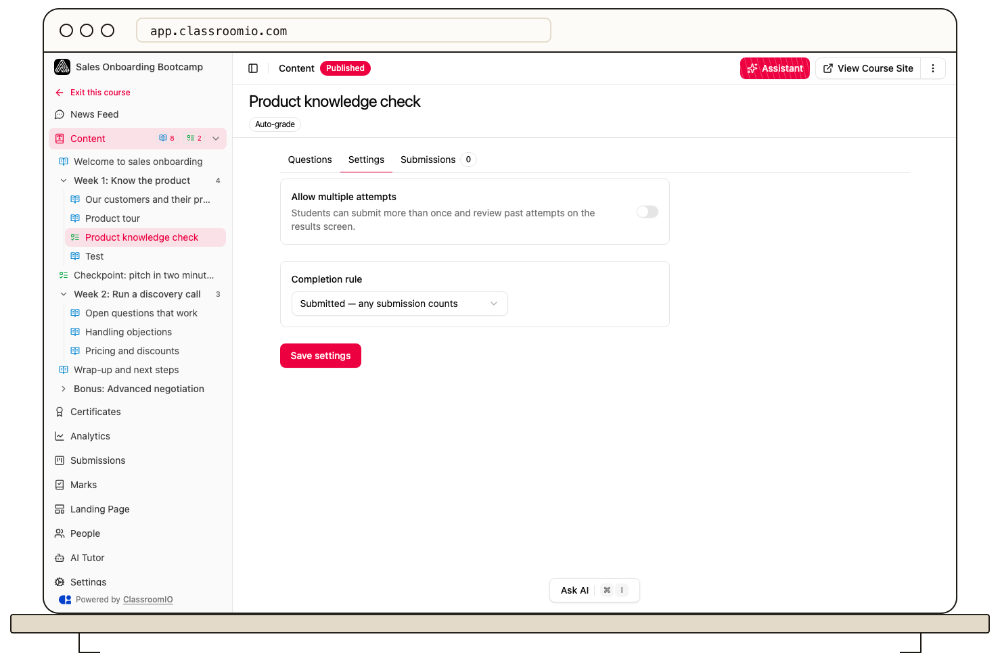

Use an exercise's **Completion rule** to decide whether submitting is enough, a passing score is required, or the exercise is optional. In a sequential course, a **Passed** rule can keep later content locked until the grade meets the threshold. A **None** rule never blocks progression.

## Set the rule

1. Open the course, then open the exercise and select **Settings**.
2. Under **Completion rule**, choose **Submitted**, **Passed**, or **None — optional**.
3. If you choose **Passed**, enter the **Pass threshold (%)** and review **Allow multiple attempts**.
4. Save the exercise and test a submission with a demo student.

**Submitted** completes the exercise when the student submits it. **Passed** waits for a score at or above the threshold. **None — optional** keeps the exercise visible and submittable but excludes it from course progress and certificate requirements. Questions needing instructor review can leave a student's progress waiting until grading is complete.

:::warning[Check the route forward after a failed attempt]
If **Passed** is required and multiple attempts are disabled, a student who fails may be unable to continue in a sequential course. Review existing submissions and attempts before changing this rule.
:::

## Related guides

- [Set answers, points, and automatic grading](/build-courses/set-answers-points-and-automatic-grading) — define scores before requiring a pass
- [Understand the submission workflow](/deliver-and-engage/understand-the-submission-workflow) — see when a grade becomes final
- [Choose free or sequential progression](/deliver-and-engage/choose-free-or-sequential-progression) — connect completion to access
