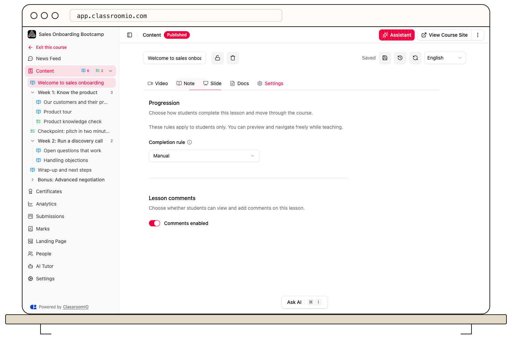

A lesson's **Completion rule** determines when it counts as finished and, in a sequential course, when it stops blocking the next item. Set the rule on the lesson itself.

## Choose a rule

1. Open the course's **Lessons**, open the lesson, and select **Edit**.
2. Open the lesson's **Settings** and find **Completion rule**.
3. Choose **Manual**, **Video watch**, or **None**. For **Video watch**, set **Watch threshold (%)**.
4. Save the lesson and reopen its settings to confirm the choice.

**Manual** lets the student mark the lesson complete. **Video watch** requires the configured share of tracked video viewing. **None** means the lesson does not block progression.

:::warning[External video cannot meet a watch requirement]
Watch tracking works for uploaded videos. A YouTube or Vimeo embed alone cannot satisfy **Video watch**. Upload the required video or choose **Manual** instead.
:::

When a video-watch rule is active, skipping ahead is restricted and playback pauses when the student switches tabs. Test the lesson as an enrolled demo student before relying on it to unlock the next item.

## Related guides

- [Choose free or sequential progression](/deliver-and-engage/choose-free-or-sequential-progression) — decide when completion unlocks the next item
- [Add or upload a video](/build-courses/add-or-upload-a-video) — choose a trackable source
- [Control progression and completion](/create-and-deliver/course-progression) — review the complete rule set
