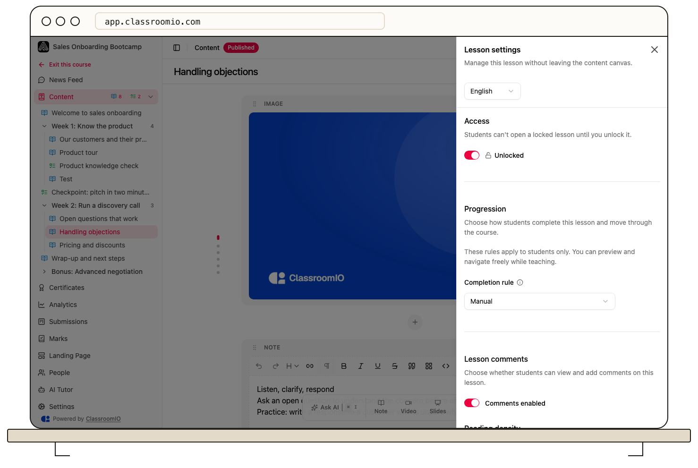

A lesson's **Completion rule** determines when it counts as finished and, in a sequential course, when it stops blocking the next item. Set the rule in the lesson's **Lesson settings** panel.

## Choose a rule

1. Open the course's **Content** and open the lesson.
2. Select the settings icon in the lesson header to open **Lesson settings**, then find **Completion rule** under **Progression**.
3. Choose **Manual**, **Video watch**, or **None**.
4. For **Video watch**, set **Watch threshold (%)** and, under **Videos to enforce**, select at least one uploaded video.
5. Close the panel. Lesson settings save automatically; reopen the panel to confirm the choice.

**Manual** lets the student mark the lesson complete. **Video watch** requires the configured share of tracked video viewing. **None** means the lesson does not block progression.

:::warning[External video cannot meet a watch requirement]
Watch tracking works for uploaded videos. A YouTube or Vimeo embed alone cannot satisfy **Video watch**. Upload the required video or choose **Manual** instead.
:::

When a video-watch rule is active, skipping ahead is restricted and playback pauses when the student switches tabs. Test the lesson as an enrolled demo student before relying on it to unlock the next item.

## Related guides

- [Choose free or sequential progression](/deliver-and-engage/choose-free-or-sequential-progression) — decide when completion unlocks the next item
- [Add or upload a video](/build-courses/add-or-upload-a-video) — choose a trackable source
- [Control progression and completion](/create-and-deliver/course-progression) — review the complete rule set
