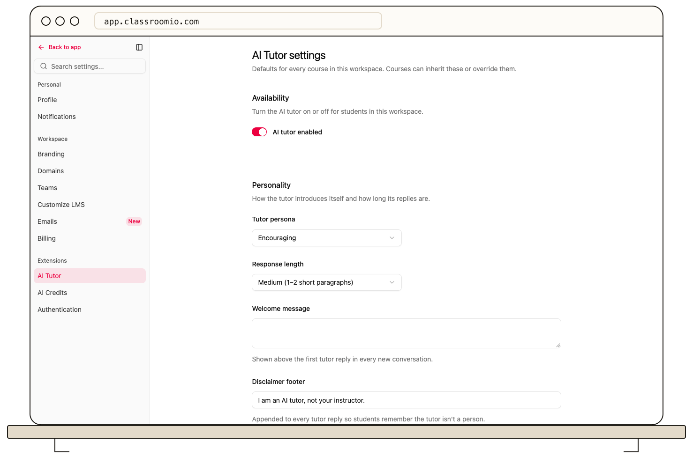

Set AI Tutor defaults under your organization's **Settings → AI Tutor**. Courses inherit these settings unless someone saves a course-level override.

## Configure the tutor

1. Open **Settings → AI Tutor** and wait for **AI Tutor settings** to load.
2. Under **Availability**, set **AI tutor enabled**.
3. Under **Personality**, choose a **Tutor persona**, **Response length**, optional **Welcome message**, and **Disclaimer footer**.
4. Under **Things to say · things not to say**, add guidance, a comma-separated list of **Forbidden topics**, and optional off-topic or sensitive-content filters.
5. Under **Exercises & assessments**, choose **Assessment mode**, when solutions may be revealed, and the **Code policy**.
6. Under **Grounding & citations**, choose the content scope and whether to require citations. Under **Escalation**, decide whether to offer an instructor contact email.
7. Select **Save changes** in the bottom action bar.

The tutor can use AI capacity when students send messages. Review your organization's [AI credits and usage](/get-started/understand-usage-and-plan-limits) before enabling a broad rollout. Test a demo course and an exercise prompt to check that assessment restrictions behave as intended.

## Related guides

- [Override AI Tutor settings for a course](/deliver-and-engage/override-ai-tutor-settings-for-a-course) — change one course without changing the defaults
- [Use AI Tutor as a student](/deliver-and-engage/use-ai-tutor-as-a-learner) — see the student experience
