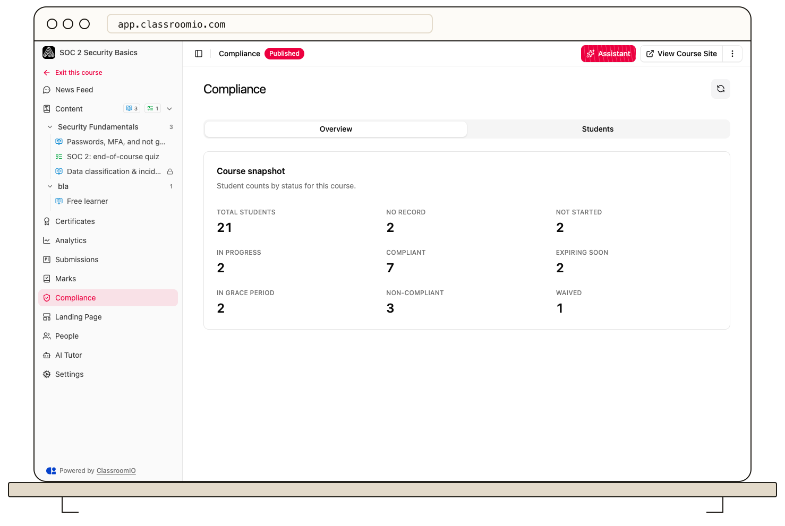

A compliance course tracks whether each assigned student is current on required training. Each student has a current cycle with a status, due date, and, after completion, a validity period.

## How a cycle works

1. Assign students to a [compliance course](/build-courses/create-a-compliance-course).
2. Students complete the required course content and meet the passing score.
3. ClassroomIO records their completion and the date their training remains valid through.
4. When that validity ends, a new cycle begins so the student can complete the course again.

Open the course and choose **Compliance** to see the course overview and the **Students** list. A student can open the same area to see **Current cycle** and **Past cycles**.

## Understand the statuses

**No record** means no current compliance record is available. **Not started** and **In progress** describe work before completion. **Compliant** means the student currently meets the requirement. **Expiring soon** warns that validity is close to ending; **In grace period** and **Non-compliant** indicate an obligation that needs attention. **Waived** means an administrator excused the current cycle.

Use [organization compliance reporting](/analytics-and-reporting/report-on-compliance-status) to review the status of all assigned students across courses.
