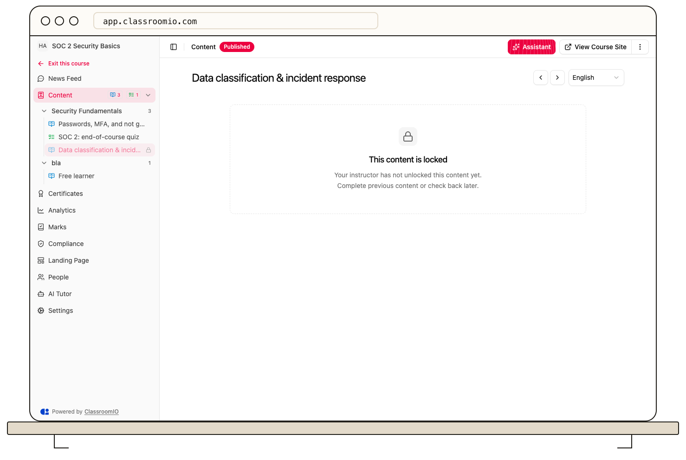

A student may see locked content because the item has its own availability lock or the course requires earlier items to be completed in sequence. Publishing the course does not clear those restrictions.

## Find the blocking rule

1. Open the course's **Settings → Content** and check **Student progression**. With **Sequential**, the student must complete earlier items in the saved course order.
2. Open the course outline and check whether the specific lesson or exercise is individually locked.
3. If an earlier lesson is unfinished, inspect its **Completion rule**. A **Video watch** rule needs an uploaded video and its configured watch threshold.
4. If an earlier exercise is unfinished, inspect whether it requires **Submitted** or **Passed**. A passing rule may wait for instructor grading or another attempt.

After changing a rule or lock, save it and test with a separately enrolled demo student. Administrator access can bypass restrictions and give a misleading result.

For a student-facing explanation, share [Understand locked content and progression](/learner-guides/understand-locked-content-and-progression).

## Related guides

- [Choose free or sequential progression](/deliver-and-engage/choose-free-or-sequential-progression) — change the course-wide mode
- [Set lesson completion rules](/deliver-and-engage/set-lesson-completion-rules) — inspect lesson requirements
- [Set exercise completion rules](/deliver-and-engage/set-exercise-completion-rules) — inspect passing requirements
