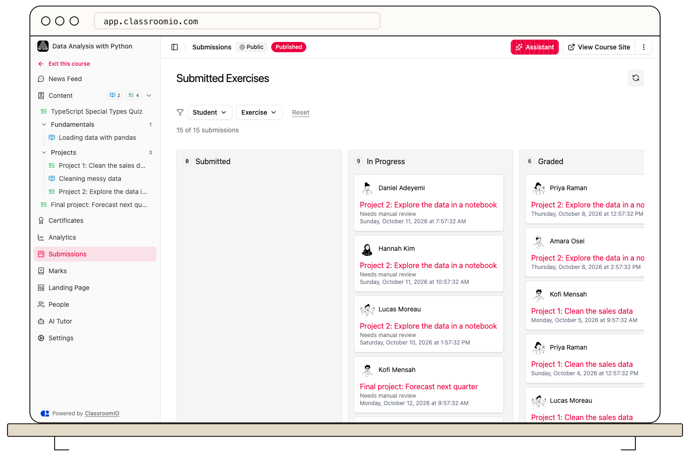

Exercise submissions appear on the course's **Submissions** tab. A manually reviewed submission moves from **Submitted** to **In Progress** to **Graded**; objective questions can be graded automatically on submission.

## What each status means

- **Submitted**: the student has handed in work that has not been reviewed yet.
- **In Progress**: a tutor or administrator has opened it for review.
- **Graded**: the review is complete and a grade has been recorded.

Open a card on the **Submissions** board to see answers, score details, and the feedback field. Review each answer, adjust scores where needed, and select **Submit Grades** to finalize the result. Open-ended or video answers may require manual grading; auto-graded exercises can move directly to **Graded**.

Students can see feedback after grading completes. A course with a **Passed** exercise completion rule may keep later content locked until the grade meets the pass threshold. If a student is waiting, check both their submission status and the exercise's completion rule.

## Related guides

- [Grade an exercise](/create-and-deliver/grade-exercise) — complete a manual review
- [Set exercise completion rules](/deliver-and-engage/set-exercise-completion-rules) — decide whether submission or passing counts
- [View and export marks](/deliver-and-engage/view-and-export-marks) — see finalized scores across the course
