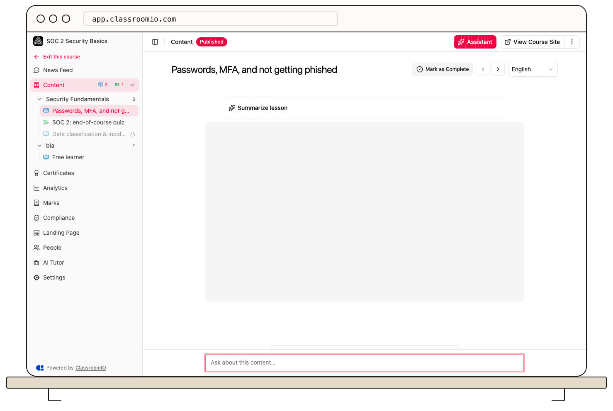

When AI Tutor is enabled for your course, select **Ask AI** while viewing course content to ask a question. The tutor may use your current lesson or other allowed course material, depending on the course settings.

## Ask a question

1. Open an enrolled course and go to the lesson or exercise where you need help.
2. Select **Ask AI** near the bottom of the content view. Enter a specific question about what you are studying and send it.
3. Read the response alongside the course material. Ask a follow-up if you need a different explanation.

The tutor may offer hints instead of direct answers, decline off-topic questions, or withhold help during an exercise. Those behaviors are set by your instructor or organization. Check citations and course content before relying on an answer; ask your instructor when the response is unclear or conflicts with a lesson.

If you see **Your AI tutor is taking a break**, read the message below it. You may have reached your monthly message limit, the organization's capacity may be used up, or the tutor may be disabled. The student message limit resets on the first day of the next month.

Avoid entering passwords, payment information, or sensitive personal details in a tutor conversation.

## Related guides

- [Understand locked content and progression](/learner-guides/understand-locked-content-and-progression) — check whether your next item is available
- [View marks and instructor feedback](/learner-guides/view-marks-and-instructor-feedback) — read the grade set by your instructor
