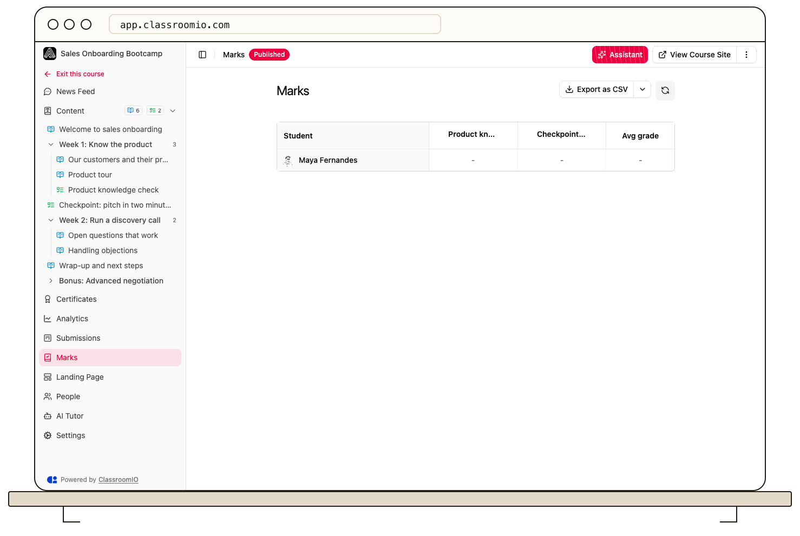

Open a course's **Marks** tab to compare students' exercise scores. Each exercise has a column, and **Avg grade** summarizes a student's recorded points across the course's scored exercises.

## Read the gradebook

From **Courses**, open the course and select **Marks**. The table shows one row per student. Exercise cells display the rounded percentage of points earned where the exercise has possible points; a dash means no mark is available. **Avg grade** divides recorded points by the total possible points across scored exercises, so an ungraded exercise can lower the average until a mark is recorded.

Organization administrators and course tutors can view the page. Students can see their own marks only when the organization's **Grading** customization is enabled; they do not see the course-wide table export.

If the page says no students are available, check that students have enrolled in the course. Use **Submissions** to inspect individual answers and grading status; the marks table is a score summary.

## Export the marks

Administrators and tutors can select **Export as CSV** and choose CSV, Excel, PDF, or HTML. The file includes student name and email, a column for each exercise, and average grade. PDF is unavailable above 2,000 rows. Exporting happens in your browser.

:::warning[Protect student grades]
The export contains names, email addresses, and marks. Save it only where authorized staff can access it.
:::

## Related guides

- [Understand the submission workflow](/deliver-and-engage/understand-the-submission-workflow) — see when scores become final
- [Exports](/reference/exports) — compare formats and limits
- [Review course performance and student progress](/analytics-and-reporting/review-course-performance-and-student-progress) — compare grades with progress
