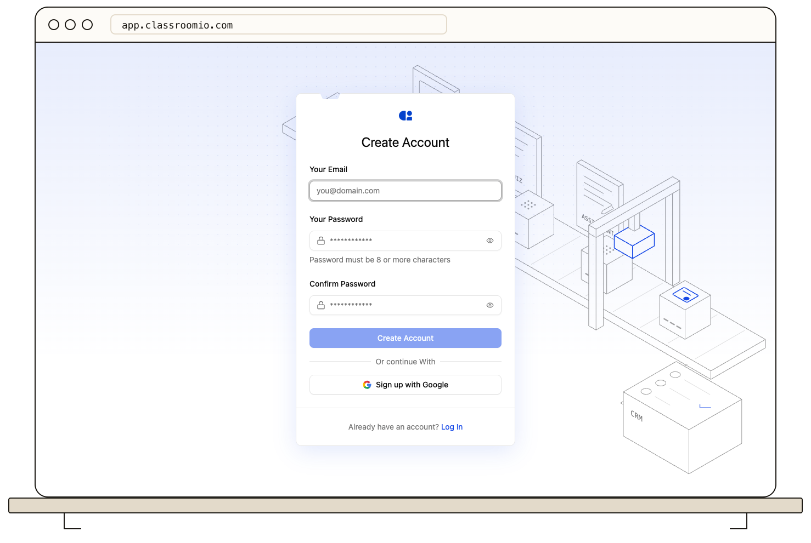

Create a ClassroomIO account to set up an organization and its academy. You can register with email and a password or use Google, then complete the six-step onboarding: your organization details, then five short questions.

## Create your account

### 1. Open the signup page

Go to [app.classroomio.com/signup](https://app.classroomio.com/signup). If you already have an account, select **Log in** instead of creating another one.

### 2. Choose how to sign up

To use email and password:

1. Enter **Your Email**.
2. Create a password with at least eight characters and no more than 72 bytes (long passphrases with multibyte characters reach the limit sooner).
3. Enter it again in **Confirm Password**.
4. Select **Create Account**.

You can also select **Sign up with Google**. If your account is subject to Single Sign-On (SSO), use the identity-provider option shown on the page.

## Create your first organization

### 1. Enter the organization details

On the first onboarding screen, enter:

- **Full Name** — the name shown on your ClassroomIO profile;
- **Name of Organization** — the name administrators and students see;
- **Academy subdomain** — the unique address for your public academy.

ClassroomIO suggests a subdomain from the organization name. You can edit it before continuing. If the address is already in use, choose another value.

### 2. Answer the setup questions

Answer five short questions: what you will use ClassroomIO for, how your customers learn your product today, your company size, your job role, and how you heard about ClassroomIO. Select **Continue** after each one. On the last question, select **Finish setup**, or **Skip** if you'd rather not say how you heard about ClassroomIO.

You are ready to start when ClassroomIO opens the admin dashboard for your new organization.

## If you already learn in an academy

If you joined another organization's academy as a student, you already have a ClassroomIO account. Use it to create your own organization instead of registering again.

1. Go to [app.classroomio.com/login](https://app.classroomio.com/login) and log in with the same email or Google account. If you tried to sign up with that email first, the signup page shows **An account with this email already exists.** Select **Log in instead**.
2. ClassroomIO opens **Pick an academy to continue**. It lists the academies you learn in and any pending invitations.
3. Select **Create organization**, then complete the onboarding steps above.

Selecting an academy under **Learning in** opens that academy's own site and signs you in there. Creating an organization does not change your student enrollments.

## If you joined through an invitation

Open the invitation link before signing up. The link preserves the organization, course, or team invitation that should be applied to your account. Some organizations allow signup only through an invitation; without the link, the signup page explains that registration is restricted.

## Related guides

- [Complete your onboarding checklist](/get-started/onboarding) — prepare the organization for students
- [Understand the admin dashboard](/organization-and-team/admin-dashboard) — learn what appears after onboarding
- [Create your first course](/get-started/create-first-course) — add the first learning experience
